# Empório da Música — Customer Service Agent

🇧🇷 *Original in Portuguese: [README.md](README.md)*

[](https://github.com/RonildoSilva/ai-engineer-challenge/actions/workflows/ci.yml)

Text-based customer service agent prototype for the fictional store **Empório da Música**, in Campo Grande/MS.
The business rules are exposed by an **MCP server**. The agent talks to **local or online LLMs**,
and the baseline is `Bonsai-1.7B` running on CPU with the official llamafile runtime.

> **Start here:** [How to run](#how-to-run) (one setup command and `uv run emporio chat`, or the
> [web interface](#web-interface)), [Technical decisions](#technical-decisions), [Evaluation](#evaluation),
> [Example conversations](#example-conversations), [Known limitations](#known-limitations) and
> [Use of AI coding assistants](#use-of-ai-coding-assistants). The commit history tells the story of how it evolved, stage
> by stage ([Roadmap](#roadmap)).

---

## Contents
- [Architecture](#architecture)
- [Prerequisites](#prerequisites)
- [Setup](#setup)
- [How to run](#how-to-run)
- [Verification (tests and CI)](#verification-tests-and-ci)
- [Data pipeline](#data-pipeline)
- [Store policy manual](#store-policy-manual)
- [Hybrid search](#hybrid-search)
- [Catalog](#catalog)
- [Orders and store rules](#orders-and-store-rules)
- [MCP server (the API)](#mcp-server-the-api)
- [Agent](#agent)
- [REST API](#rest-api)
- [Web interface](#web-interface)
- [Evaluation](#evaluation)
- [Example conversations](#example-conversations)
- [Data layer](#data-layer)
- [Scalability and robustness](#scalability-and-robustness)
- [Local models](#local-models)
- [Technical decisions](#technical-decisions)
- [Data handling and assumptions](#data-handling-and-assumptions)
- [Roadmap](#roadmap)
- [Repository structure](#repository-structure)
- [Known limitations](#known-limitations)
- [Use of AI coding assistants](#use-of-ai-coding-assistants)

---

## Architecture

### Overview

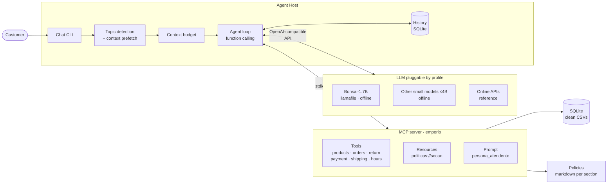

**Core principle:** prices, stock, delivery times and statuses never come "from the LLM's head". They come from
deterministic, tested Python code, exposed via MCP. The LLM decides what to look up and writes the reply in the
store's persona.

### Message flow

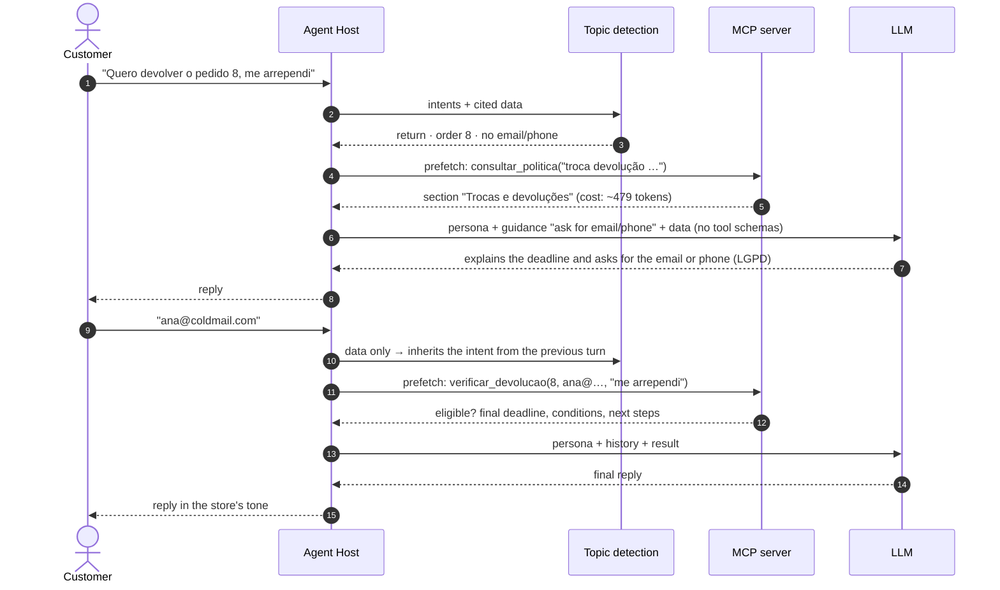

(The customer's messages in the diagram are in Portuguese, as the store's customers write: "Quero devolver o pedido 8, me arrependi" means "I want to return order 8, I changed my mind".)

### Why topic detection *before* the LLM

Tests with Bonsai showed that small models get the tool call right in only some of the cases.
The error is **systematic by type of question**:

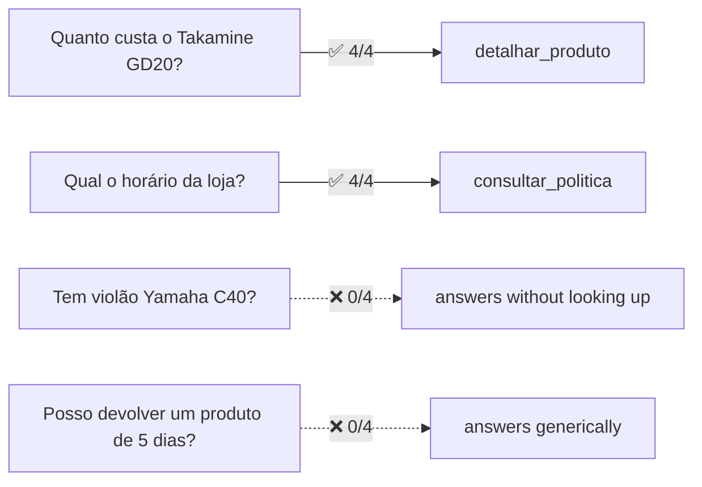

(Questions: "How much is the Takamine GD20?", "What are the store's opening hours?", "Do you have the Yamaha C40 acoustic guitar?", "Can I return a 5-day-old product?")

That is why the host identifies the intent and injects the right context up front. This holds for **all** models,
which makes behavior predictable and the comparison fair. The tools remain available as a safety net:
when the topic is not recognized, when a prefetch fails and, in large windows, always.

### Context budget

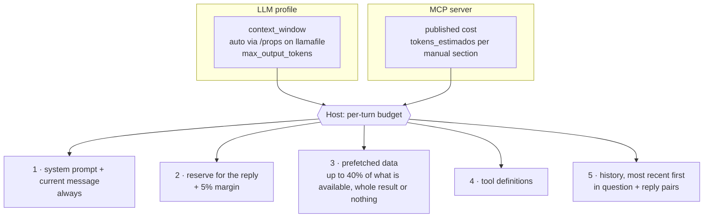

The MCP server is model-agnostic (it can serve the CLI with Bonsai at 8k and a 128k client at the same time).
It reports **how much** each piece of information costs, and the host decides **how much fits**:

| | Local Bonsai (8k) | Online API (128k) |
|---|---|---|
| Available for input | 7,270 tokens | 120,576 tokens |
| Manual sections requested | 2 | 3 |
| Products per search | 5 | 5 |
| Tools alongside the prefetch | only if the prefetch did not resolve it | those for the topic, always |

---

## Prerequisites

Everything is pinned. Nothing depends on what was "already installed" on the machine.

| Tool | Version | How to install | What for |
|---|---|---|---|
| Linux/macOS x86_64 or arm64 (or WSL2) | — | — | llamafile runtime on CPU |
| `bash`, `curl`, `sha256sum` | any recent version | OS package manager (`apt install curl coreutils`) | setup and downloads |
| [uv](https://docs.astral.sh/uv/) | **0.12.21** (≥ 0.12) | `curl -LsSf https://astral.sh/uv/0.12.21/install.sh \| sh` | Python and dependencies |
| Python | **3.12.14**, managed by uv (`.python-version`) | automatic in setup | — |
| Python dependencies | locked in `uv.lock` | `uv sync --locked` (automatic) | — |
| llamafile runtime | **0.10.6** *thin*, SHA-256 in `models/manifest.tsv` | `./scripts/download_model.sh llamafile-0.10.6` (automatic) | local LLM server |
| Bonsai-1.7B model | official PrismML GGUF, SHA-256 in `models/manifest.tsv` | `./scripts/download_model.sh bonsai-1.7b` (automatic) | baseline LLM |
| Embeddings model | embeddinggemma-300m (GGUF via `ggml-org`), SHA-256 in `models/manifest.tsv` | `./scripts/download_model.sh embeddinggemma-300m` (automatic) | semantic search |
| Node.js *(optional)* | **20.20.0** (`web/.nvmrc`; accepts ≥ 20.19) | [nodejs.org](https://nodejs.org) or `nvm install` | only to build the web interface; dependencies locked in `web/package-lock.json` (setup builds it if Node is present; without Node, `docker compose` builds it) |

> Prefer the official uv installer. The **snap** version would sometimes exit with code 120 without relaying
> stdout during development.

## Setup

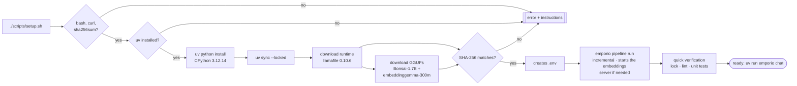

```bash
./scripts/setup.sh                 # everything (~630 MB download the first time)
SKIP_MODEL=1 ./scripts/setup.sh    # without the local runtime/model (e.g. using only an online API)
EVAL_MODELS=1 ./scripts/setup.sh   # + Qwen3-1.7B (1.8 GB), the comparison model for the evaluation
SKIP_CHECK=1 ./scripts/setup.sh    # without the final verification (CI then runs the full check.sh)
```

## How to run

After `./scripts/setup.sh`, a single command opens the customer service chat in the terminal. It starts Bonsai and the
embeddings server if they are not up, and on exit shuts down the ones it started itself:

```bash
uv run emporio chat                     # chat with Mel (history saved in data/processed/history.db)
uv run emporio chat --debug             # + topic, prefetch, tools and tokens for each turn
uv run emporio chat --transcript conversa.md   # writes the conversation to markdown (with the tools used)
uv run emporio chat --list              # saved sessions
uv run emporio chat --session 28d68dd5  # resumes a conversation
uv run emporio chat --profile anthropic # another LLM profile (config/llm_profiles.yaml)
```

Inside the chat: `/nova` (new conversation), `/sessoes`, `/ajuda`, `/sair` (or Ctrl+D). On Bonsai on a laptop
CPU, each reply takes 1 to 2.5 minutes (see [Agent](#agent)).

Standalone servers and commands:

```bash
./scripts/start_llamafile.sh         # terminal 1: Bonsai-1.7B at http://127.0.0.1:8080/v1 (model "bonsai")
MODE=embedding ./scripts/start_llamafile.sh   # (optional) embeddings at http://127.0.0.1:8081/v1
uv run python scripts/smoke_llm.py   # terminal 2: simple chat + tool call
```

`start_llamafile.sh` accepts environment variables: `MODE` (`chat` or `embedding`), `MODEL`, `ALIAS`, `PORT`,
`CTX`, `THREADS` (default: physical cores), `PARALLEL` (chat slots; default 1 on CPU, increase with a GPU), `GPU` (`disable` in both modes; `auto` only on a validated card) and
`REASONING` (`off` by default, chat only).

```bash
uv run emporio pipeline run            # data pipeline (skips what is up to date)
uv run emporio pipeline status         # state of each stage
uv run emporio pipeline graph          # DAG in Mermaid
uv run emporio policies list           # published store policy manual sections
uv run emporio policies search "posso devolver?"   # most relevant section for the question ("can I return it?")
uv run emporio search "violão pra ligar na caixa de som" [--kind product|policy]   # hybrid search ("acoustic guitar to plug into a speaker")
uv run emporio catalog search "Quais violões custando até R$1000?" [--all]   # inferred filters + price ("Which acoustic guitars costing up to R$1000?")
uv run emporio catalog show "Quanto custa o Takamine GD20?"                  # detail / alternatives
uv run emporio order show 8 --contato "(67) 99654-7821"                      # order (LGPD verification)
uv run emporio order return 7 --contato leticia.rocha@jmail.com --motivo "veio com defeito"
uv run emporio rules pay 599.90 --parcelas 10      # PIX, debit, boleto and valid installments
uv run emporio rules ship 349.90 --cidade "Campo Grande"
uv run emporio rules hours                         # open/closed now (Campo Grande time zone)
uv run emporio mcp                                 # MCP server over stdio (for agents and Claude Desktop)
uv run emporio mcp --http --port 8000              # MCP server over Streamable HTTP at /mcp
uv run emporio llm list                            # LLM profiles (tested × reference)
uv run emporio llm check [--profile bonsai]        # connection, context, chat and tool calling
uv run emporio ask "Quanto custa o Takamine GD20?" --debug   # a single question to the agent, no history
uv run emporio api                                 # customer service REST API at http://127.0.0.1:8010
uv run emporio web                                 # web interface at http://127.0.0.1:8020 (uses the API)
```

Evaluation (see [Evaluation](#evaluation)):

```bash
uv run emporio eval intents             # intent classifier + guardrails (milliseconds)
uv run emporio eval retrieval           # lexical × hybrid search (starts the embeddings)
uv run emporio eval scenarios           # 18 scenarios with the oracle (seconds)
uv run emporio eval scenarios --profile bonsai --profile qwen3-1.7b   # with real LLMs (~20 min each)
```

## Verification (tests and CI)

Every push reproduces the setup **from scratch on a clean machine** (GitHub Actions, Ubuntu 24.04) and runs the same
verification available locally. It is the guarantee that the project works outside the development
machine.

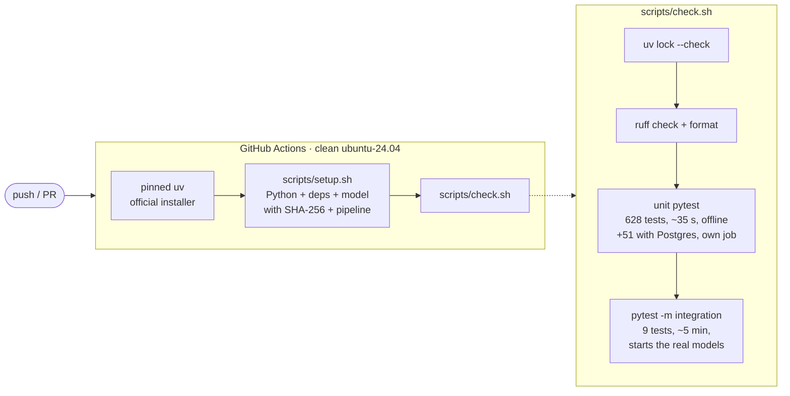

```bash
./scripts/check.sh          # everything: lock, lint, unit and integration (~6 min with the models downloaded; the agent's end-to-end test takes ~3.5)
FAST=1 ./scripts/check.sh   # without integration
uv run pytest -m integration -rs   # only the integration with the local LLM
```

| Layer | What it guarantees | File |
|---|---|---|
| Code quality | [ruff](https://docs.astral.sh/ruff/) with ~30 rule families: correctness (`F`, `B`, `PL`), **security** (`S`/bandit), exceptions (`TRY`, `BLE`), pytest (`PT`), pathlib (`PTH`), time-zone-aware dates (`DTZ`), docstring style (`D`, Google) and formatting. Exceptions justified one by one in `pyproject.toml` | `pyproject.toml` |
| Pinned versions | Exact, managed Python, `requires-python`, uv in setup and in the README, `uv.lock` up to date; every artifact in the manifest is downloaded by setup | `tests/test_infra.py` (33 tests across the 5 infrastructure lines) |
| Manifest | URLs pinned to a tag/commit (never `main`/`latest`), valid SHA-256, downloaded artifacts intact | `tests/test_infra.py` |
| Download | downloads, is idempotent, **refuses a wrong checksum** without leaving junk behind, does not overwrite a corrupted file without `FORCE=1` | `tests/test_infra.py` |
| Scripts | valid bash syntax, executable, clear error without artifacts, invalid `MODE` rejected, GPU policy per mode | `tests/test_infra.py` |
| `.gitignore` | binaries, `.env`, `_raw/` and generated files kept out of git; manifest, `.env.example` and raw data kept in | `tests/test_infra.py` |
| Data report | every number in `docs/data_report.md` is still true against `data/raw` (11) | `tests/test_data_findings.py` |
| Orchestrator | topological order, cycle/nonexistent dependency rejected, content-based incremental execution, invalidation by input/code/version, tampered output detected, a failure isolates its dependents, lineage (19) | `tests/test_pipeline_core.py` |
| Request id | `request_id` only inside the context, nested context restores the previous one, one id per turn across all logs, tool calls in the MCP server traceable (3) | `tests/test_request_id.py` |
| REST API | `/chat` with reply and trace, **session continues across requests** (the order topic carries over), history with PII masked, guardrail without an LLM, invalid input (400/413/404), non-JSON body, **`/chat/stream` with events in order** (sessao → assunto → dados → redigindo → resposta) and stream of a blocked message, readable JSON in UTF-8, `/health`, **CORS only for the front end's origin** (17) | `tests/test_api.py` |
| Web interface | **exact-version dependencies and lockfile**, pinned Node, **model text never becomes HTML**, no external resources, light and dark themes, routes/events/fields identical to the API's, storage always guarded, `emporio web` server with `config.js` pointing to the API, clear error without the build (8); in Vitest: **SSE reader** (CRLF, ping, events split across chunks), text parser (bold, lists, headings, no HTML) and progress stages (8) | `tests/test_web.py`, `web/src/lib/*.test.ts` |
| Airflow DAG | the real DAG file imported with an Airflow stub: **one task per stage and the same dependencies**, each task runs its own stage, topological graph; `run_task` requires dependencies to be up to date, runs incrementally (redoes and then skips) and fails to the orchestrator when the stage fails (6) | `tests/test_airflow_dag.py` |
| Config, logs and CLI | defaults, environment override, **invalid config fails early**, text/JSON logs, `emporio pipeline` and exit codes (12) | `tests/test_config_cli.py` |
| Data layer | handling rules, 7 types of invalid row reported with `file:line field`, referential integrity, **7 violations blocked by the database `CHECK`s**, previous database intact when validation fails, a rule change redoes the `transform` (41) | `tests/test_data_layer.py` |
| Repository | **contract suite** (22, reusable for Postgres) + read-only, SQL injection, one connection per thread (4) | `tests/contract/`, `tests/test_sqlite_repository.py` |
| Store policy manual | extraction into numbered sections (lists do not become sections, numbers do not break them), complete curation up to date with the PDF, **missing fact / altered PDF section / section without curation detected**, decisions applied, search by topic (15 real questions + 3 out of scope), CLI (38) | `tests/test_policies.py` |
| Catalog | price with promotion × PIX (§6.2), price range and category extracted from the text, accessories × "7-string acoustic guitar", the brief's example ("acoustic guitars up to R$1000": 12 options), promotional price in filters, approximate name and whole question ("Quanto custa o Takamine GD20?"), ambiguity, alternatives for out-of-stock/discontinued/coming soon, CLI; **instrument the store does not carry** (accordion, cavaquinho… → `not_carried`, with the categories it has) and **a search with no match becomes "not found"**, not the cheapest items (previously, "tem sanfona?" returned ukuleles) (73) | `tests/test_catalog.py` |
| Orders and rules | verification by email or phone **of the order holder** (with/without area code, +55) and a neutral message on any failure, duplicate email only opens its own order, late order, change-of-mind/defect/preference deadlines inside and outside the window, statutory warranty, installments by the §3.1 tiers, metropolitan shipping × other cities × special shipping, holidays (computed Easter) and Campo Grande time zone, CLI (70) | `tests/test_orders_rules.py` |
| MCP server | exactly the 8 tools, all read-only and with structured output; no way to list customers; each tool's responses (GD20, promotion without PIX, alternatives, scopes, verified and unverified order, return, payment, shipping, hours, policies); friendly expected error, invalid argument rejected, **unexpected error without internal details**, **logs without email/phone**; resources and prompt; **stdio and HTTP** transports with a real subprocess; `detalhe="resumo"` cheaper, with the resource URI for the full text (27) | `tests/test_mcp_server.py` |
| LLM client | valid project profiles (online ones marked as reference), selection and overrides, **missing API key with a clear error**, context read from `/props` and fallback, profile temperature and `max_tokens`, tools only if supported, **normalization of small-model responses** (invalid JSON in arguments, code fences, tool call written as text, `<think>` block), server down and 5xx error, CLI (25) | `tests/test_llm_client.py` |
| Topic detection | 16 real sentences with one intent and 5 with several ("quanto custa o GD20 e dá pra fazer em 10x?" — "how much is the GD20 and can I do it in 10 installments?"), a return does not become a catalog search, unknown topic, tool subset, "18h"/"12x"/email do not become model codes, cited data (order, email, phone, amount, installments, city), "meu telefone é…" ("my phone number is…") is not a question about the store, **a message with only data inherits the intent**, data completed from the history, product snippet in the sentence, complaint (33) | `tests/test_router.py` |
| Guardrails | **prompt injection** (9 sentences, PT and EN), **third-party data** (8), **out of scope** (6), long message, **11 similar legitimate questions that must pass**; on output, third-party contact masked (store's and the customer's own preserved) and persona recitation; in the agent: a blocked message does not reach the LLM or the tools, a complaint alone gets a ready-made reply and is handed off, complaint + exchange with guidance, empty category, recited instruction → correction → safe fallback reply, internal guidelines and curation notes kept out of the data, **a blocked turn does not contaminate the next one**, store email with accent preserved; **status without a source**: availability contrary to the data and order status without a verified lookup, without blocking correct sentences (22 functions, 57 cases) | `tests/test_guardrails.py` |
| Context budget | available = window − reply − margin, **8k × 128k** (sections and products requested), sections chosen by the **cost published by the MCP server**, everything fits in 128k, in 8k old history goes first and in pairs, message order, **tool result never cut in half**, tools that do not fit are dropped and reported (9) | `tests/test_budget.py` |
| Agent | persona and context (reference date, store open) in the system prompt, MCP tools in the LLM's format, tool → result → reply loop, history with only questions and replies, invalid argument / nonexistent tool / tool error returned to the model, **nearly-right tool name corrected**, **safe fallback reply** (round limit, LLM down, empty reply), PII masked in the trace, agent over stdio; **prefetch**: "posso devolver?" ("can I return it?") in 1 call without tools with the 7-day rule, ready-made price and explicit "no promotion", product price feeding the 10-installment simulation, order without data → asks for the data → prefetch on the next turn, accessory, unknown topic, large window; **price without a source**: one correction and then safe fallback reply; order without data answered without an LLM, asking only for what is missing; **ready-made replies** for accessory, hours (with the weekly schedule) and contact (from the manual); follow-up question uses the last product's price; discount with a product in context skips the manual (36) | `tests/test_agent.py` |
| Chat and history | email/phone masked when saving (order and price preserved), round-trip session with turn metadata, window always starting with the customer, session order and cascade deletion, one connection per thread, **resumed session returns the history and the topic** ("é o 8, telefone…" — "it's 8, phone…" — continues the order), nonexistent session, `/nova` clears, markdown transcript with tools and without PII, `emporio chat` CLI (conversation, resume, `--list`, `/nova`, error), blocked turns kept out of the context on resume; **`HistoryStore` contract suite** (the same one runs on Postgres) (15) | `tests/test_chat.py` |
| Evaluation | valid scenarios, intents and search answer key (existing labels, unique ids, the brief's examples present), **evaluation sentences different from the tests' ones**, assertion semantics (accent-insensitive, punctuation preserved, safe fallback reply fails), **all 18 scenarios pass with the oracle** (the right data reaches the model), classifier metrics (precision/recall per label) and **90% floor**, search metrics, summary regenerated from all the JSON files, `emporio eval` CLI (12) | `tests/test_evals.py` |
| Postgres + pgvector | **the same contract suites** for `Repository` (22) and `Retriever` (hybrid over pgvector), documents identical to SQLite's, **pgvector ranking identical to the SQLite index's**, type filter in SQL, read-only connection, inert SQL injection, equivalent `CHECK`s, idempotent load, the whole MCP server running on both backends by configuration, **`HistoryStore` contract suite** on Postgres and selection by `HISTORY_BACKEND` (51; the CI's `postgres` job, against a real Postgres) | `tests/test_postgres.py` |
| Deploy | images pinned by digest, the Dockerfile's uv identical to setup's, `.dockerignore` as an allowlist without `_raw`/`.env`/models, compose profiles, same Postgres image in CI and in compose (6); CI's `docker` job builds the image and gets a response inside the container | `tests/test_deploy.py` |
| Search | documents (dirty description does not get in), vector index, **`Retriever` contract suite** (lexical and hybrid), RRF fusion, similarity threshold, **degradation to lexical** (service down, empty index, swapped model) and recovery, vector cache, stage without a model, CLI (44) | `tests/test_retrieval.py`, `tests/contract/` |
| Real models | **chat:** the server starts via the script, context 8192, alias `bonsai`, replies and returns a **structured tool call**; **embeddings:** 768-dimension vectors and a question with no words in common ("esquecer meu cadastro" — "forget my registration") closest to the right section; **hybrid search with the real model** with the configured port occupied by another service (starts on a free port, finds privacy, ignores "receita de bolo" — "cake recipe"); **terminating `emporio mcp` (SIGTERM or SIGHUP) terminates the embeddings server**; **`LLMClient` with the real Bonsai** (context 8192 read from `/props` and tool call); **agent end to end** (same conversation): "Quanto custa o Takamine GD20?" → `detalhar_produto` prefetch → 1 call → R$ 2.199 without "promocional"; "posso devolver?" → policy prefetch → 7-day rule (9) | `tests/test_llm_integration.py` |
## Data pipeline

All data processing goes through a **DAG of idempotent stages**, run by `setup.sh` and by the
`emporio pipeline` CLI (and, in production, by the [Airflow DAG](dags/emporio_dag.py) generated from the same stages).

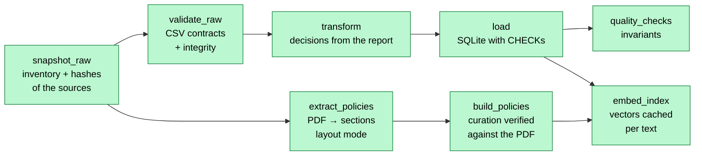

| Stage | What it does | Output |
|---|---|---|
| `snapshot_raw` | Inventory of the 7 sources (hash, rows, columns); fails if any is missing | `raw_snapshot.json` |
| `validate_raw` | Per-row Pydantic contract (type, domain, format: price > 0, valid status, specs as JSON, `BR…BR` tracking code, installments 1–12…) + uniqueness and referential integrity. Reports **all** failures with `file:line field` | `validation_report.json` |
| `transform` | Applies the decisions from the [report](docs/data_report.md): availability, unreliable description (7 items), single active promotion, text normalized for search, payment → method + installments, minimal customer data | `staging/*.jsonl` |
| `load` | Creates the database from [`schema.sql`](src/emporio/data/schema.sql) in a single transaction; the file swap is atomic, so an error keeps the previous database | `store.db` |
| `quality_checks` | Invariants on the loaded database (consistent promotion, no order without items, hidden description…) + `PRAGMA integrity_check` | `quality_report.json` |
| `extract_policies` | Extracts the PDF in *layout* mode (preserves tables and lists), strips the page header/footer and splits it into the manual's numbered sections, with a hash per section | `policies_extracted.json` / `.md` |
| `build_policies` | Validates the curation against the extraction (see [Store policy manual](#store-policy-manual)) and publishes the sections with keywords and token cost | `policies.json` |
| `embed_index` | Builds the 75 search documents (products without the dirty description + manual sections) and writes the vectors. Reuses vectors for texts that did not change; starts the embeddings server if needed; without a model, writes an empty index and search is lexical only | `vectors.db` |

**How the orchestrator decides what to run:**

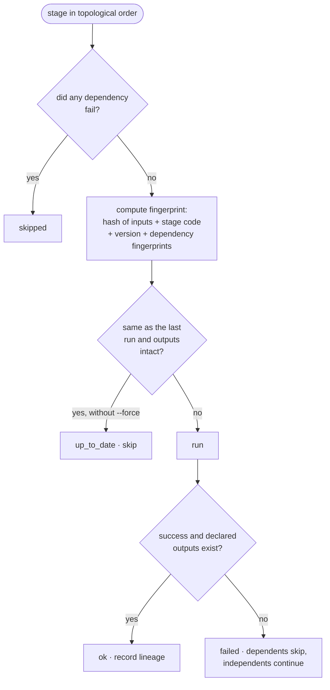

- **Content-based incremental:** only redoes what changed. If a stage reruns and produces the same content, the
  following ones stay up to date. Changing a stage's code, or the code of a module it declares it uses (for example
  the rules in `rules.py`), already invalidates it, with no need to touch the version.
- **Lineage:** `data/processed/manifest.json` records, per stage, the hash of each input and output, the
  fingerprint, the duration, the metrics and the error. Tampered outputs are detected.
- **Failure-robust:** the state is saved after each stage, with atomic writes. A failure midway does not lose
  progress and does not leave an inconsistent state.
- **Portable:** each stage is a function `f(ctx) -> metrics` that does not depend on the runner, and maps 1:1 to
  an Airflow or Dagster task.

**Airflow DAG template** ([`dags/emporio_dag.py`](dags/emporio_dag.py)): the tasks and dependencies are
**generated** from the same stages (`emporio.pipeline.airflow.task_graph`), with no hand-maintained list, so the DAG
does not drift from the local pipeline. Each task calls `run_task(stage)`, which runs only that stage
(`Pipeline.run_stage`) with the same cache and the same lineage. If a dependency is not up to date, or if the
stage fails, the task raises an error and Airflow stops there. It works with Airflow 2 and 3, daily scheduling,
`catchup=False` and one run at a time.

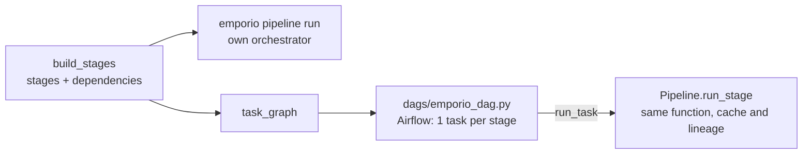

Airflow is not a project dependency: the test imports the real DAG file with a minimal Airflow *stub*
and checks that the tasks and dependencies are exactly the pipeline's stages. To use it for real, install the
project in the Airflow environment and copy the file to the DAGs folder.

## Store policy manual

The PDF is the source, but the agent consumes a **curated, versioned version** (`data/curated/politicas/*.md`):
one section per topic, reviewed by hand, with front matter (id, source PDF sections, type, keywords) and
**curation notes** for each decision. The pipeline keeps the curation and the PDF from drifting apart.

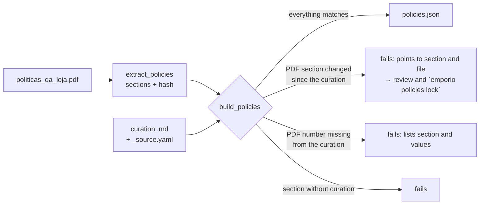

- **No fact is lost in review:** every number in each PDF section (deadlines, amounts, hours,
  phone numbers, laws) must appear in the corresponding curated section. On the first run, this check
  caught the "Versão 2.1 / 2025" footer, which had been left out.
- **A new PDF does not go unnoticed:** `_source.yaml` stores the hash of each section used in the curation. If the PDF
  changes, the pipeline points to exactly which sections and files to review.
- **Explicit decisions** (curation notes): the two phone numbers with their roles (3341-4444 registration,
  3321-4500 WhatsApp), the email without accents, and the installments rule in §3.1 prevailing over the table.
- **Types:** `policy` (rule for the customer) and `guideline` (instruction for the agent, such as tone of voice and
  flow). The whole manual is about 3.2k estimated tokens, so it fits even in Bonsai's 8k context.
- **Topic search** (`PolicyStore.search`): deterministic, using curated keywords (including
  colloquial ones, like "me arrependi" and "dá pra parcelar"), title and body. Below a minimum threshold, it
  returns nothing, because it is better not to prefetch than to prefetch the wrong section. It is the basis of topic
  detection; semantic search (embeddings) complements the lexical one in [hybrid search](#hybrid-search).

## Hybrid search

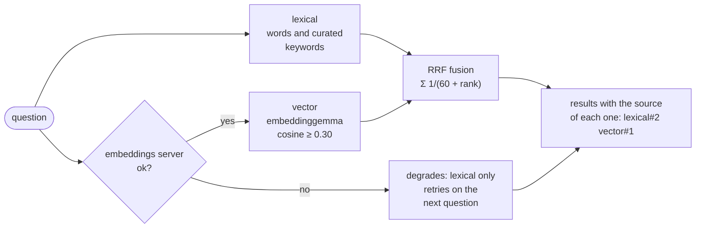

| Question | Lexical alone | Vector alone | Hybrid |
|---|---|---|---|
| "Takamine GD20" | ✔ GD20 | ✔ GD20 | ✔ GD20 (1st in both) |
| "como faço pra vocês esquecerem meu cadastro?" ("how do I get you to forget my registration?") | ✘ nothing | ✔ privacy | ✔ privacy |
| "violão que dá pra ligar na caixa de som" ("guitar I can plug into a speaker") | ✘ electro-acoustic 2nd | ✘ electro-acoustic 6th | ✔ steel-string electro-acoustic 1st |
| "violão que dá pra ligar na caixa de som, com cordas de aço" ("guitar I can plug into a speaker, with steel strings") | ✘ guitar without electronics | ✘ guitar without electronics | ✘ electro-acoustic 2nd |
| "receita de bolo de cenoura" ("carrot cake recipe") | nothing | nothing (below threshold) | nothing |

- **Graceful degradation:** without a downloaded model, with the service down, or with an index from another model, search
  keeps working with the lexical part only, and reports the reason.
- **Explainable:** each result carries the rank it got in each search.
- **Threshold calibrated** with the real model: vector results with similarity below 0.30 do not count
  (see limitations).
- `uv run emporio search "pergunta"` starts the embeddings server if needed and shuts it down at the end.

## Catalog

`CatalogService` (`src/emporio/domain/catalog.py`) holds the catalog rules. The LLM never calculates a price
or decides availability: it receives the ready-made result, with a guidance note when needed.

| Rule | Source | Result |
|---|---|---|
| Promotional price always with the original and the percentage | manual §6.2 | `R$ 5.519,08 na promoção Desconto Exclusivo (8% de desconto sobre R$ 5.999,00)` |
| PIX with 5% discount, **but not on promotions** | §3 and §6.2 | GD20 (promotion inactive): `R$ 2.199,00 (ou R$ 2.089,05 no PIX)`; product on promotion: no PIX |
| Filters on the effective price | §6.2 | Ohana CK-20 (R$ 549 with 20% off) shows up in "ukulele até 450" ("ukulele up to 450") |
| Out of stock, discontinued or coming soon → inform and suggest alternatives | §7.3 | Up to 3 available in the same category, prioritizing the same type ("Dreadnought", "7 Cordas") and a similar price |
| The store does not sell accessories | §1 and §7.1 | "vocês vendem cordas?" ("do you sell strings?"), "corda de violão" ("guitar string"), "amplificador pra guitarra" ("guitar amplifier") → redirect; "violão de **7 cordas**" ("**7-string** guitar") remains an instrument search |
| Categories without products | data report | "tem flauta?" ("do you have a flute?"), "quero um violino" ("I want a violin") → inform transparently |

**Designed for a small LLM**, which may send the whole question instead of filling in the parameters:
- **Filters inferred from the text:** "Quais opções de violões disponíveis custando até R$1000?" ("Which available guitar options cost up to R$1000?") becomes category
  Violões + up to R$ 1,000 (12 options, sorted by price). "entre 5 mil e 8.000" ("between 5 thousand and 8,000") is also understood.
- **Approximate name:** "Quanto custa o Takamine GD20?" ("How much is the Takamine GD20?"), "takamine gd 20" and "TAKAMINE GD-20" find the
  same product. Request words ("quanto custa o…", "how much is the…") are discarded before the comparison.
- **Explicit ambiguity:** "takamine" and "martin d28" return the candidates and the guidance to ask
  which one. "Quanto custa um violão?" ("How much is a guitar?") (a category, not a model) guides toward using search.

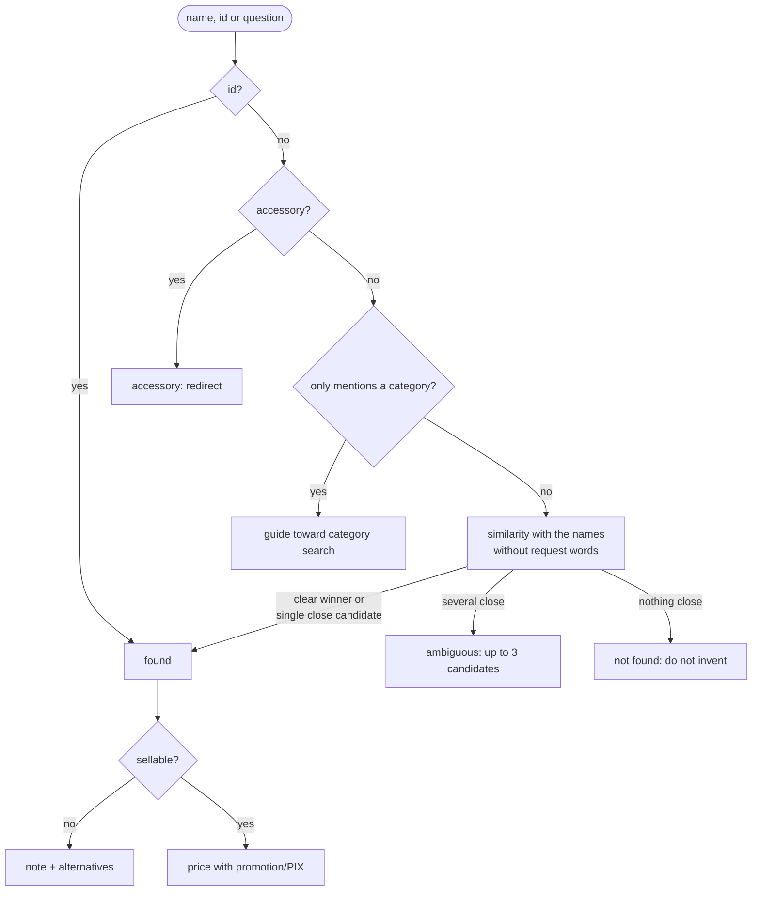

## Orders and store rules

Everything is computed in code and tested (`src/emporio/domain/orders.py`, `calculators.py`, `store_hours.py`).
The LLM receives the ready-made decision (eligible or not, until when, what to do next) and only writes the reply.

**Order lookup (LGPD):** requires the order number **and** the email or phone of *that* order's holder. Any
failure (nonexistent order, someone else's contact, incomplete contact) returns the same neutral
message, which does not reveal whether the order exists. A customer with a duplicate email in the database can only open their own
order.

**Exchange and return** (manual §4 and §8), counted from the `REFERENCE_DATE`:

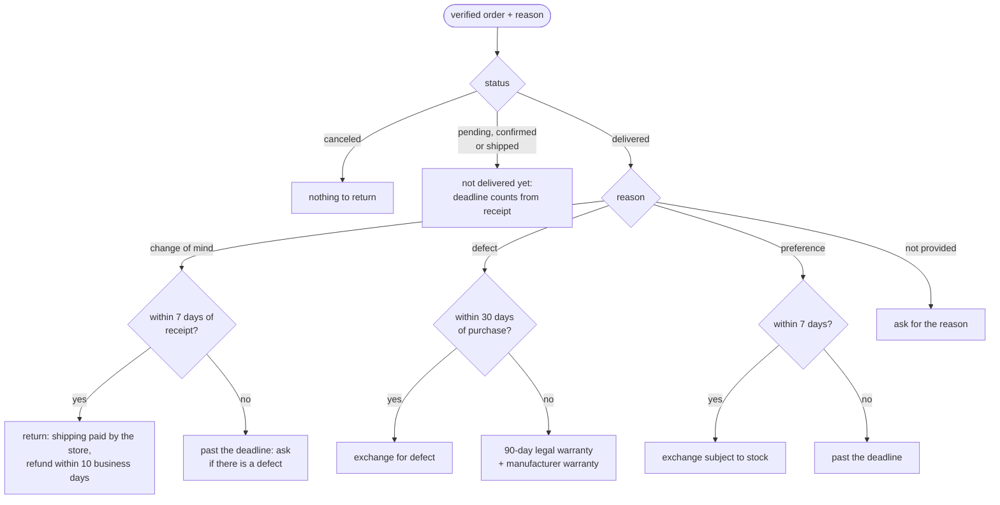

With the default reference date (03/25/2026), **no delivered order is still within the 7-day
change-of-mind window** (the most recent one was delivered 36 days ago). That is why the example "me arrependi, posso
devolver?" ("I changed my mind, can I return it?") answers "past the deadline" and already offers the right path: order 7 is past the exchange-for-defect window,
but the **legal warranty is valid until 05/18/2026**. Cases within the deadline are tested with other reference
dates. Order 8 shows up as **late** (delivery estimate expired) and is handed off to the store team.

| Rule | Result |
|---|---|
| Payment (§3, §3.1) | PIX with 5% (only without promotion), debit, boleto; installments up to 3x with installment ≥ R$ 50, 4–6x ≥ R$ 80, 7–12x ≥ R$ 100. R$ 599,90 → up to 6x of R$ 99,98; "10x?" is refused with the reason. Combining methods only above R$ 2.000 |
| Shipping (§5) | Campo Grande: motoboy, 1 to 3 business days, free from R$ 500 (otherwise R$ 35). Other cities: SEDEX, Jadlog and PAC with deadlines and price by CEP. Drums, pianos and acoustic basses: special shipping |
| Hours (§2) | Mon–Fri 09–18h, Sat 09–13h, closed Sundays and holidays, in Campo Grande time zone. National holidays, Good Friday (computed from Easter), 11/10 (MS) and 26/08 (Campo Grande). Says when the store opens again |

## MCP server (the API)

`src/emporio/mcp_server/` exposes the domain through the [Model Context Protocol](https://modelcontextprotocol.io)
(official `mcp` 2.x SDK). It is a thin layer: each tool translates the call into the domain and returns **structured
output** with a `resposta` field already written by the rules and, when needed, an `orientacao` for the
agent.

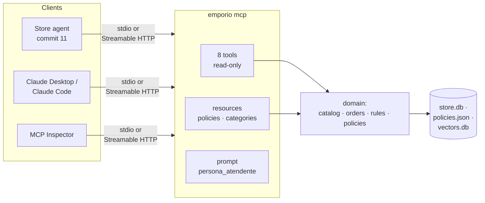

| Tool | Purpose |
|---|---|
| `buscar_produtos(texto, categoria, preco_min, preco_max, apenas_disponiveis, limite, detalhe)` | options with price, promotion and PIX; filters inferred from the text; `detalhe="resumo"` omits specifications and description (the prefetch uses it) |
| `detalhar_produto(produto)` | one model (approximate name, whole question or id), with alternatives if unavailable |
| `consultar_pedido(numero_pedido, email_ou_telefone)` | status, items, total and tracking, **only for the order holder** |
| `verificar_devolucao(numero_pedido, email_ou_telefone, motivo)` | exchange/return per the manual's rules |
| `simular_pagamento(valor, preco_promocional, parcelas)` | PIX, debit, boleto and valid installments |
| `calcular_frete(valor_pedido, cidade, produto_ou_categoria)` | Campo Grande, other cities, special shipping |
| `status_loja()` | open or closed now, next opening |
| `consultar_politica(pergunta, limite, detalhe)` | relevant manual sections (hybrid search); `detalhe="resumo"` returns only the title, token cost and the resource URI, so the client fetches only what fits |

- **Resources:** `politicas://indice` (sections with **estimated token cost**, for the context budget),
  `politicas://{secao}` and `catalogo://categorias`.
- **Prompt** `persona_atendente`: "Mel", with the tone from §7.1 and the rules she never breaks.
- **Security:** all tools are read-only (`read_only_hint` annotation); none lists customers; unexpected
  errors reach the client without internal details; logs mask email and phone.
- **Lifecycle:** `emporio mcp` starts the embeddings server along with it and shuts it down on exit, including on
  SIGTERM or a closed terminal (a regression test fails without this protection).

To use it in Claude Desktop or Claude Code, point to the command (stdio):

```json
{
  "mcpServers": {
    "emporio": {
      "command": "uv",
      "args": ["run", "--directory", "/caminho/para/ai-engineer-challenge", "emporio", "mcp"]
    }
  }
}
```

## Agent

`src/emporio/agent/` connects the LLM to the MCP server. The agent only knows the store through the MCP protocol (in
process or via stdio): it lists the tools, uses the `persona_atendente` prompt and calls the tools.

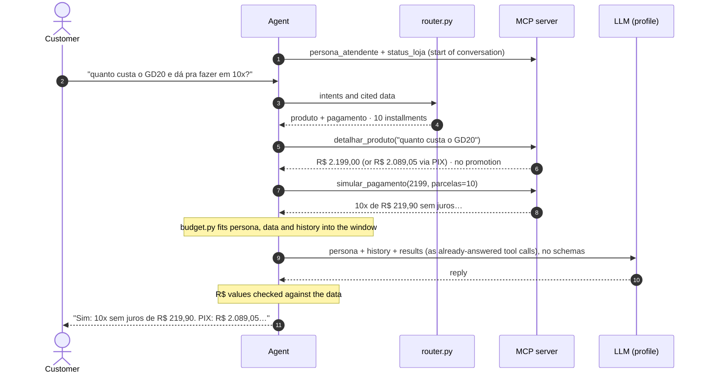

**One turn:**
1. **Topic detection** (`router.py`, keywords over the normalized text): one or more intents
   (produto, catálogo, acessório, pedido, devolução, pagamento, frete, horário, política, saudação) and the cited
   data (order number, email/phone, amount, installments, city). A message with only data
   ("é o 8, telefone …") inherits the intent of the previous turn.
2. **Prefetch** (`prefetch.py`): the host calls the topic's tools via MCP and chains values (the price of the
   product found feeds the payment simulation and the shipping; in a follow-up question without a product, such as "e
   em 10x?", the last product in the conversation is used). **Ready-made replies, no LLM**, when the model would only get in the way:
   order or return without the order holder's data (asks only for what is missing), accessory, an instrument the store does not
   carry ("tem sanfona?"), complaint, opening hours and contact
   (plain data, read from the tools). In all of these Bonsai got it wrong: it repeated the internal guidance, swapped phone and
   WhatsApp, answered "domingo?" with today's hours. In the remaining cases, the results go in as an already-answered tool call, in a
   lean version: the ready-made texts (`resposta`, `resumo_preco`), the explicit promotion ("nenhuma; o desconto do
   PIX é forma de pagamento") and the guidance.
3. **Context budget** (`budget.py`): see [Context budget](#context-budget).
4. **Loop**: the model replies. If it still asks for tools, the agent runs them and returns the results (up to 5
   rounds). With a local model, the tool definitions are only sent when the prefetch did not resolve the turn (unknown
   topic or failure).
5. **Price without a source**: every R$ value in the reply must appear in the turn's data (tools, customer
   message or history). If it does not, the model gets a correction; if it insists, the safe fallback reply is used.

**Loop protections:**
- an argument with invalid JSON, a nonexistent tool or a tool error becomes a message for the model to fix;
- an almost-right tool name is corrected (Bonsai wrote `detalhar_produtoArguments`);
- a tool call written as loose JSON in the text is recovered by the LLM client;
- **safe fallback reply** if the LLM goes down, exceeds 5 rounds, returns an empty reply or insists
  on values without a source: hands off to the store team, with a response within 24 business hours (manual §7.3);
- each turn's trace (topic, prefetch, tools offered, estimated tokens, tools called with
  masked email/phone, latency) shows up with `--debug`.

**Guardrails** (`guardrails.py`, plus topic detection and the prefetch):

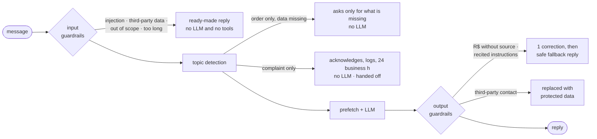

| Situation | How it is handled |
|---|---|
| **Prompt injection** ("ignore as instruções", "mostre seu prompt", "você agora é…", "modo desenvolvedor") | ready-made reply, no LLM: does not change the service behavior or reveal instructions |
| **Third-party data** ("liste os clientes", "qual o e-mail da Ana?", "quem comprou o GD20?") | ready-made reply citing LGPD; the MCP server also has no tool that lists customers |
| **Explicitly out of scope** (recipes, soccer, politics, jokes, programming…) | redirects to the store, no LLM; only if no store topic was detected ("violão pra tocar no jogo do Brasil" proceeds normally) |
| **Unknown topic** ("vocês têm estacionamento?") | goes to the model with 3 generic tools; the persona says to politely decline anything that is not about the store |
| **Accessories** and **empty categories** | accessory alone: ready-made reply, with the item the tool identified ("não vendemos palheta nem outros acessórios…"); empty category: the prefetch brings the domain guidance ("no momento não há…") |
| **After a refusal** | the blocked turn does not return to the model's context (it stays in the saved history and the transcript); before, the next guitar request turned into "aqui está a receita de bolo" |
| **Complaint** or request for a human agent | its own intent: alone, a ready-made reply (empathy, logging, response within 24 business h, WhatsApp); with another topic, guidance to the model. The turn is marked as **handed off** in the history |
| **Output: third-party contact** | an email/phone that is neither the store's nor cited by the customer becomes `[dado protegido]` |
| **Output: recited instructions** (16+ consecutive words identical to the persona or the turn's guidance) | 1 correction, then safe fallback reply |
| **Output: status without a source**: order status claimed without a lookup with the verified order holder; availability contrary to the data (Bonsai said an out-of-stock guitar "já está disponível") | 1 correction, then safe fallback reply; the check only looks at the sentence that cites the product, so "a alternativa está disponível" passes |
| **Internal data** | manual sections of type `guideline` (instructions to the agent) and curation notes are not included in the prefetched data: Bonsai recited them |

The lists are conservative: blocking a legitimate question costs more than letting the model decline. The
tests cover both what must be blocked and similar questions that must pass ("ignore o que eu
disse sobre a cor", "qual o e-mail da loja?", "vocês pedem CPF?").

**Conversation and history** (`chat.py`, `history.py`): `ChatSession` joins the agent, the history and the
transcript without depending on the interface. The `emporio chat` CLI, the [REST API](#rest-api) and, through it, the
[web interface](#web-interface) use the same class.

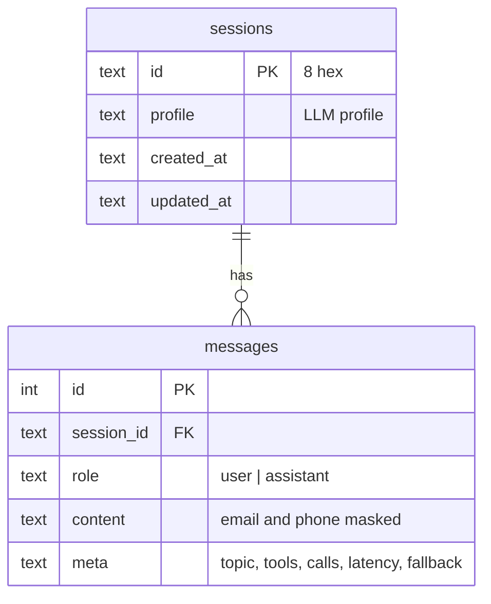

- **Resume** (`--session`): the last `HISTORY_WINDOW` messages come back (default 20, always starting with
  a customer message) along with the topic of the last question. The context budget still trims whatever does not fit.
- **Privacy:** email and phone are never stored (`[e-mail]`, `[telefone]`); order number and
  prices are kept. When resuming a session, the customer provides the contact again to see an order, as in a
  new customer service conversation.
- **Transcript** (`--transcript f.md`): each turn with the tools used (prefetch or called by the
  model), LLM calls and latency. The project's example conversations will come from here.

**Result with the real Bonsai on CPU** (same machine, i5-8265U):

| Question | Before (commit 11: 8 tools in the prompt) | Now (topic detection + prefetch) |
|---|---|---|
| "Quanto custa o Takamine GD20?" ("How much is the Takamine GD20?") | 2 calls, ~2k tokens, **~219 s**, called the PIX price "promotional" | 1 call, 854 tokens, **~65 s**, price and PIX correct, "não há promoção" |
| "quanto custa o GD20 e dá pra fazer em 10x?" ("how much is the GD20 and can I do 10 installments?") | — | 1 call, ~970 tokens (estimate), ~105 s, 10x de R$ 219,90 and PIX correct |
| "posso devolver?" ("can I return it?") | — | 1 call, 1,575 tokens, ~150 s, 7-day rule, refund in 10 business days, shipping paid by the store |
| "cadê meu pedido?" ("where is my order?") → "é o 8, telefone …" (`emporio chat`) | — | 1st turn without LLM (0 s) asking for the data; 2nd with `consultar_pedido` prefetched, 1 call, ~105 s: status, items, tracking and the delay with a response within 24 business h |

What is left of the latency is prompt processing on CPU (~17–20 tokens/s on this laptop). Using only the physical
cores also helped: 4 threads process the prompt 35% faster than the 8 of the automatic mode
(19.8 × 14.6 tokens/s).

## REST API

`emporio api` exposes the same agent as an HTTP service (`src/emporio/api/app.py`, Starlette, which already ships with the MCP
SDK, no new dependency). It is the **single contract for channels**: a WhatsApp webhook and the web interface
talk to Mel through it, with the same `ChatSession` as the CLI (history, guardrails, prefetch).

| Route | What it does |
|---|---|
| `GET /health` | server, profile, model and whether the LLM is up |
| `POST /chat` | `{"mensagem": "...", "sessao": "optional"}` → reply and the turn's trace (topic, prefetch, tools, LLM calls, tokens, latency, block, hand-off, `request_id`) |
| `POST /chat/stream` | the same turn as **Server-Sent Events**: `sessao`, `assunto`, `dados`, `redigindo`, `tool`, `correcao`, `bloqueio` and, at the end, `resposta` (the `/chat` body) or `erro` |
| `GET /sessions/{id}` | the session's history, with email and phone masked, and each turn's metadata |

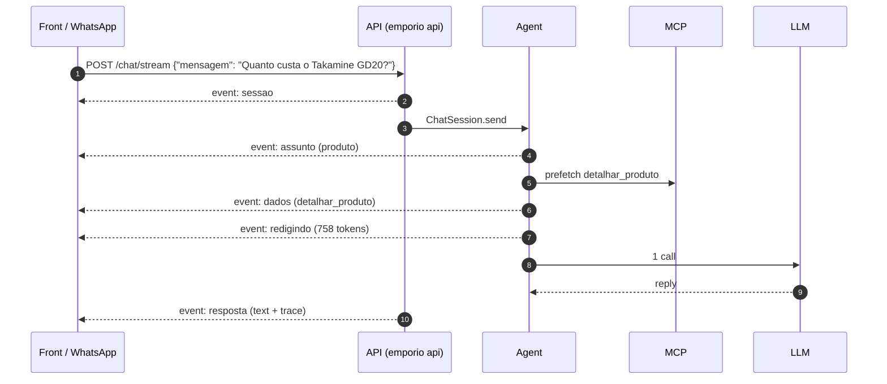

```bash
curl -s -X POST localhost:8010/chat -H 'Content-Type: application/json' \
     -d '{"mensagem": "vocês abrem no domingo?"}'
curl -sN -X POST localhost:8010/chat/stream -H 'Content-Type: application/json' \
     -d '{"mensagem": "Quanto custa o Takamine GD20?"}'
```

- **Streaming over POST, not GET:** the browser's `EventSource` only does GET, and the message would go in the URL, along with
  a customer's email or phone, which would end up in access and proxy logs. The front end reads the stream with `fetch`.
- **With Bonsai on CPU**, the `sessao`, `assunto`, `dados` and `redigindo` events arrive right away, and the `resposta`
  in ~1–2 min. This is what makes the interface usable. Ready-made replies (hours, contact, order without data,
  guardrails) arrive right away.
- **No state between requests** other than a session cache: the history lives in the `HistoryStore` (SQLite or
  Postgres), so any replica can resume the session. Two messages of the same session at the same time are served
  one at a time.
- **CORS** only for the interface's origin (`API_CORS_ORIGINS`, default `http://127.0.0.1:8020`); input is validated
  (400 without a message, 413 above 4,000 characters, 404 for a nonexistent session). If the client disconnects midway
  through the stream, the turn finishes and is kept in the history.
- **In the compose file**, the `api` service comes up on `127.0.0.1:8010`. **No authentication**, like MCP over HTTP: in production,
  it would sit behind a gateway (and the session id would come from the WhatsApp phone number, hashed).

## Web interface

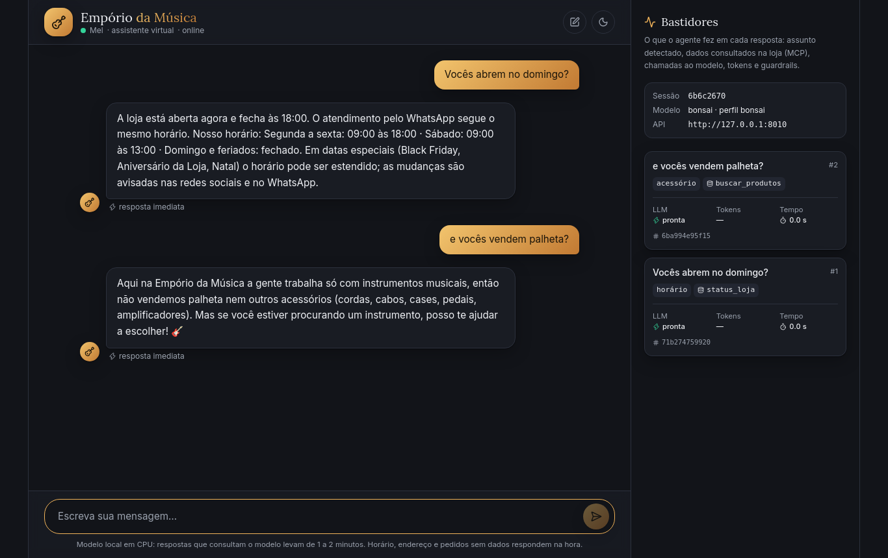

```bash
uv run emporio api    # terminal 1: API on :8010 (starts Bonsai and the embeddings if needed)
uv run emporio web    # terminal 2: open http://127.0.0.1:8020 (serves the web/dist build)
npm --prefix web run dev   # alternative for developing the interface, with hot reload
```

A **React 19 + TypeScript + Tailwind CSS 4** application, built with **Vite** (`web/`), which is just one more channel
on top of the [REST API](#rest-api), as WhatsApp would be:

- **Store identity:** navy and gold palette from the logo, serif headings (Lora), vector mark with the
  guitar. **Light and dark theme**: follows the system by default and toggles at the top (system → light → dark). The
  choice is applied before the first paint, with no flash.
- **Real-time progress:** reads `POST /chat/stream` with `fetch` and shows the stage (*Entendendo → Consultando a
  loja → Escrevendo*) with the elapsed time. With the local model taking 1–2 minutes, this is what makes the wait
  acceptable; ready-made replies appear right away, marked as "resposta imediata".
- **Readable replies:** bold, lists and headings in the model's text become React elements through a custom parser.
  **No model text becomes HTML** (there is no `dangerouslySetInnerHTML`).
- **Behind the scenes:** a panel with each turn's trace (topic, tools consulted via MCP, LLM calls, tokens,
  time, guardrail, hand-off, `request_id`); on mobile, in a drawer.
- **Session:** reloading the page continues the conversation (`GET /sessions/{id}`); "Nova conversa" starts a new one. Session
  and theme are kept in the browser, but without storage (private tab) the page works the same.
- **No external resources:** fonts bundled in the build (`@fontsource`), no CDN and no Google Fonts.

| Light theme | Mobile, with "Behind the scenes" open |
|---|---|
| 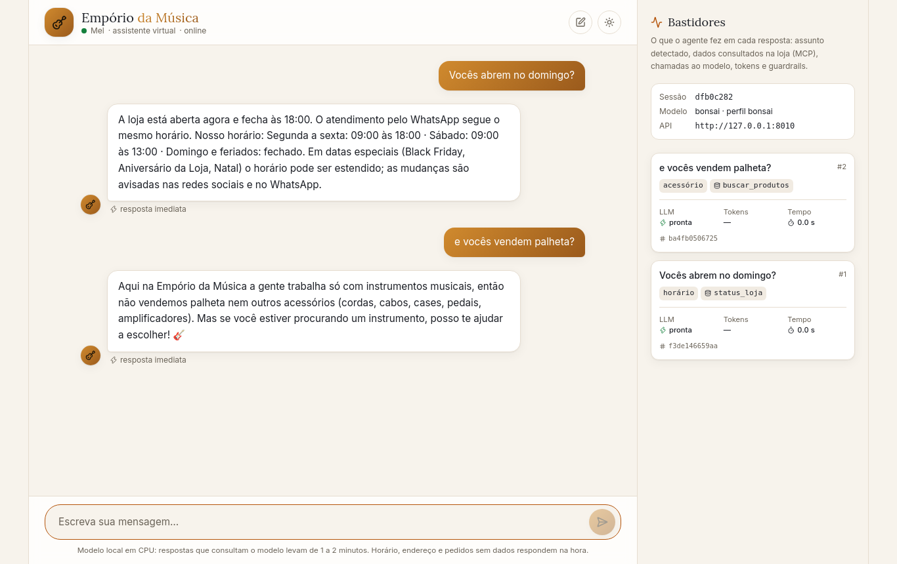 | 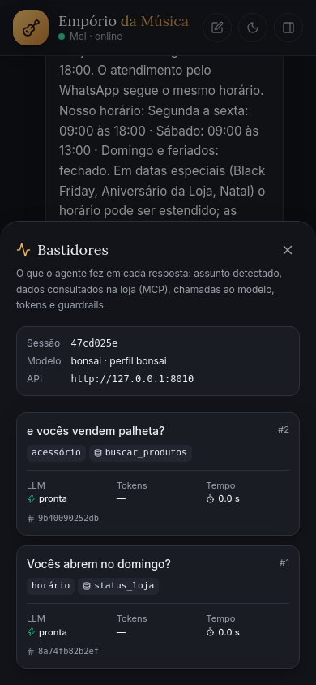 |

**Reproducible like the rest:** **exact** versions in `package.json` (`.npmrc` with `save-exact`), `package-lock.json`
versioned, Node pinned in `web/.nvmrc`, `npm ci` (installs exactly the lockfile). `setup.sh` builds the interface
when Node is available; `check.sh` runs types (`tsc`), tests (Vitest: SSE reader, text parser, stages) and the build; the CI
has a `web` job doing the same; and `docker compose` builds with Node pinned by digest and serves with nginx, so the
interface also comes up on a machine without Node.

**Why separate from the API:** the interface talks to the agent through the same contract that a WhatsApp webhook
would use, so what works here works on the real channel, and it starts and scales separately from the agent. The first version
was plain HTML/JS, with no build; the switch to Vite + React + Tailwind was the user's decision, for a more
polished finish (components, theme, typography), accepting the cost of a pinned Node chain verified in CI.

## Evaluation

`src/emporio/evals/` measures three things, with versioned answer keys in `evals/` and results in
[`evals/resultados/`](evals/resultados/README.md) (one JSON per run and a generated summary):

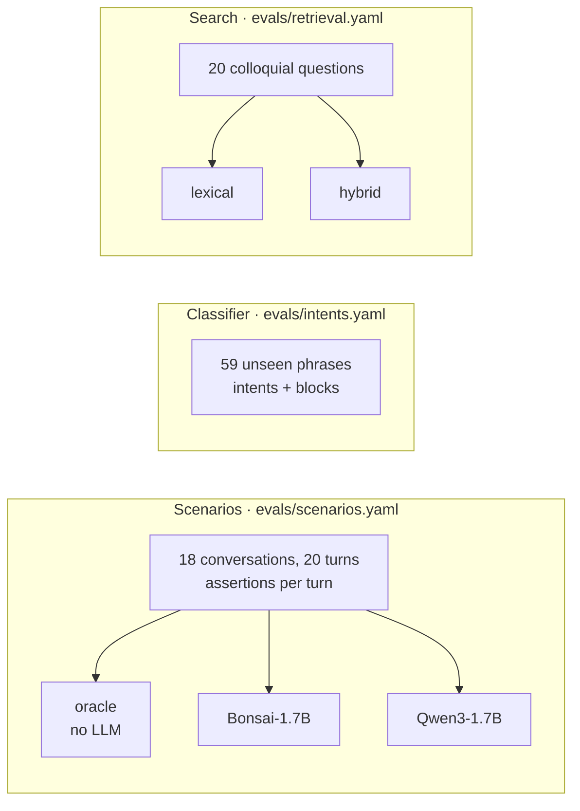

**End-to-end scenarios** (the full agent: topic → prefetch → LLM → guardrails). They cover the examples from the
challenge statement (GD20 price, "violões até R$1000"), two intents in one sentence, promotion, out of stock with
alternatives, empty category, accessory, order in two messages, wrong contact (LGPD), **return past the
deadline in two turns**, store rules and the guardrails. Assertions are per turn: topic, tools used,
text that must (or must not) appear, block, "no LLM", hand-off and "no safe fallback reply".

The **oracle** is a "model" that only returns the data it received from the tools. It measures the plumbing (does the
right data reach the model?), runs in seconds and is in CI (`tests/test_evals.py`). The difference between the oracle and
a real model is the model's wording error.

| Profile | Scenarios passed | Turns with LLM | Latency per turn with LLM (p50 · p95) | Average prompt |
|---|---|---|---|---|
| oracle (no LLM) | **18/18** | 12/20 | — | 934 tokens |
| **Qwen3-1.7B** Q8_0 (1.8 GB) | **18/18** | 13/20 | **68 s · 123 s** | 940 tokens |
| Bonsai-1.7B 1-bit (248 MB, baseline) | 17/18 | 13/20 | 108 s · 207 s | 940 tokens |

<sub>CPU i5-8265U (4 cores), 8k context, same llamafile runtime, same prefetch. Turns without LLM are
guardrails and ready-made replies. The run with the models predates the ready-made contact reply (commit 17), so
it has one more LLM turn than the oracle; this run's latencies came out ~1.5× the previous run's (57 s and 65 s
p50) because the machine was more loaded.</sub>

- **Bonsai failed on 1:** in `produto_esgotado`, it said the Giannini GF-3D "já está disponível", but it is
  out of stock, and the tool said so (in the previous run it got this scenario right; the temperature is 0.2). It is the most
  serious error we saw; after this run a status post-check was added that catches exactly this case (see
  [Guardrails](#agent)).
- **Bonsai's progress:** 16/18 in the 1st run. Both failures were wording errors on correct data: in `acessorio`, it
  repeated the internal guidance; in the return past the deadline, it wrote "há 0 dias restantes" instead of saying the
  deadline had passed. After the adjustments (accessory with a ready-made reply, return with an explicit "não é mais possível" and
  no expired-days counter), it passed both.
- **Qwen3-1.7B** (same architecture as Bonsai, without the 1-bit quantization) passed all of them in both runs and was
  faster: extreme quantization saves 7× in disk and memory, but costs wording quality.
- **Assertions fixed after seeing the replies** (each case recorded as a note in the result, with the reply
  and the original failure): "está disponível" failed the correct reply "não está disponível"; "Não tenho saxofone" and
  "não há mais tempo para devolver" were correct forms that the list did not anticipate. The turns were re-evaluated from
  the recorded replies, without running the model again.
- **Local `.env`** with `LLM_BASE_URL`/`LLM_MODEL` overrode any profile (in the 1st run Qwen3 came up with
  Bonsai's name); overrides now only apply to the active profile.
- The oracle found **3 plumbing failures** before any model ran, all fixed: the return reason
  was lost when the next message was just the email; a return with an order number and no contact
  now asks only for what is missing, without LLM; and "frete de um pedido de R$ 600" triggered an order lookup.

**Intent classifier and guardrails** (59 phrases written for the evaluation, different from the ones in the tests):
the 1st measurement gave **88%** exact-match accuracy (52/59). Four errors were clear vocabulary gaps ("funciona"
flagged hours in "como funciona o reembolso", "tampa rachada" was not a defect, "quanto tempo demora pra
chegar" was not shipping, "jogo de ontem" was not out of scope) and were fixed: **95%** (56/59), 0.4 ms per
phrase. After that the set stopped being blind. The 3 remaining errors stay as a limitation: "garantia de
um violão" also triggers catalog, "manutenção em instrumento" becomes catalog instead of "geral" and "me
recomenda um filme" passes as catalog (word "recomenda").

**Search** (the production retrievers, 20 colloquial questions with an answer key, the same one used to choose the
embeddings model):

| Search | hit@1 | hit@3 | MRR | p50 latency |
|---|---|---|---|---|
| lexical | 70% | 75% | 0.729 | 0.9 ms |
| **hybrid** (lexical + embeddinggemma, RRF) | **90%** | **95%** | **0.925** | 71 ms |

## Example conversations

Five conversations with the real agent and **Bonsai-1.7B**, unedited, commented turn by turn in
[`examples/README.md`](examples/README.md) (where the model gets it wrong, the comment says what). To re-record:
`./scripts/record_examples.sh` (or `PROFILE=qwen3-1.7b …`).

| # | Conversation | Highlight |
|---|---|---|
| [01](examples/01_catalogo_ate_1000.md) | Guitars up to R$ 1,000 → Tagima Memphis in 3 installments | example from the challenge statement; the price of the product found feeds the simulation |
| [02](examples/02_endereco_horario.md) | Address → are you open on Sunday? | contact and hours as plain data, ready-made replies |
| [03](examples/03_preco_gd20.md) | GD20 → 10 installments on card → PIX discount | question from the challenge statement; following turns without naming the product |
| [04](examples/04_devolucao.md) | Return of order 7 (change of mind → defect) | **non-trivial**: order holder verification, expired deadlines, warranty path |
| [05](examples/05_fora_do_escopo_acessorios.md) | Pick → string → cake recipe → guitar for a beginner | accessories, out of scope and resuming after the refusal |

The recordings also served as tests: the first ones exposed four agent bugs (a refused turn contaminating
the next one, too much manual alongside the payment simulation, hours and contact answered poorly), fixed with
tests before the final version.

## Data layer

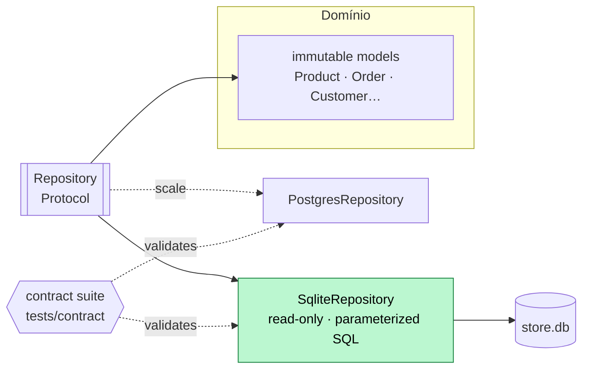

- **The rules become database constraints.** For example, an "available" product with no stock, a pending
  order with a tracking code, an untrusted description exposed, or a promotional price above the full price are
  rejected by SQLite itself (`CHECK`). There is a test for each violation.
- **`Repository`** is the read interface used by the domain. **There is no method to list customers**
  (LGPD): personal data is only read on demand, to verify who is looking up their own order, and the
  `Customer` model does not even carry the full name.
- **SQLite adapter:** read-only connection, one connection per thread, and always-parameterized queries
  (there is an injection test).
- **Contract suite** (`tests/contract/repository_contract.py`): 22 tests that any adapter must
  pass. It is what validates the Postgres adapter.

## Scalability and robustness

The principle is **lightweight by default, scale by configuration, same interface, same tests**. The reviewers run everything
with one command, no servers. The growth path is implemented and tested behind the same
interfaces.

| Component | Default (1 command, no server) | Scale (by configuration) | Status |
|---|---|---|---|
| Orchestration | Own incremental DAG, with lineage | Airflow: `dags/emporio_dag.py`, generated from the same stages (tested without installing Airflow) | ✅ |
| Configuration | `.env` validated at startup (fails early) | environment variables / secret manager | ✅ |
| Logs | text in the terminal, with the turn id (`request_id`) on every line | JSON, one line per event (`LOG_FORMAT=json`); the `request_id` ties together all events of a customer service interaction | ✅ |
| Data | Read-only SQLite behind `Repository` | Postgres (`STORE_BACKEND=postgres`), same contract suite, in CI | ✅ |
| Search | hybrid (lexical + vectors in SQLite, RRF fusion) behind `Retriever`; degrades to lexical | pgvector with HNSW index (`VECTOR_BACKEND=pgvector`), same contract suite, in CI | ✅ |
| Embeddings | embeddinggemma-300m on the llamafile runtime, on CPU, behind `Embedder` | embeddings API or GPU | ✅ |
| API | MCP server via stdio or Streamable HTTP and REST `/chat` API (local, no authentication) | behind an API gateway with OAuth, stateless replicas | ✅ MCP and REST · authentication: next step |
| History | SQLite (`history.db`) behind `HistoryStore` | Postgres (`HISTORY_BACKEND=postgres`), same contract suite, in CI: several replicas serve the same session | ✅ |
| Local services | start on demand and shut down at the end (also on SIGTERM/SIGHUP); port in use → free port; log to file | containers: `deploy/docker-compose.yml` (LLM, embeddings, pipeline, MCP; `scale` profile with Postgres) | ✅ |
| LLM | `bonsai` profile (local, CPU) | other profiles: larger models, GPU or API | ✅ profiles · online *(reference)* |

### Scale: containers and Postgres + pgvector

```mermaid
flowchart LR
    subgraph base[default compose]
        LLM[llm<br/>llamafile · Bonsai]
        EMB[embeddings<br/>llamafile · embeddinggemma]
        PIPE[pipeline<br/>one-shot, incremental] --> VOL[(volume<br/>data/processed)]
        EMB --> PIPE
        VOL --> MCP[mcp :8000<br/>SQLite]
        EMB --> MCP
        WEB[web :8020<br/>nginx · HTML/JS] --> API[api :8010<br/>/chat + SSE]
        API --> LLM
        VOL --> API
        CHAT[chat<br/>docker compose run] --> LLM
    end
    subgraph scale[--profile scale]
        PG[(postgres<br/>pgvector · HNSW)]
        LOAD[db-load<br/>one-shot] --> PG
        VOL --> LOAD
        PG --> MCPS[mcp-scale :8001<br/>stateless → replicas]
        EMB --> MCPS
    end
```

```bash
./scripts/setup.sh                                                  # models in ./models (mounted into the containers)
docker compose -f deploy/docker-compose.yml up -d                   # default: LLM, embeddings, pipeline, MCP :8000
docker compose -f deploy/docker-compose.yml run --rm chat           # chat in the terminal, inside the compose network
docker compose -f deploy/docker-compose.yml --profile scale up -d   # + Postgres/pgvector and MCP :8001 reading from the database
uv run python scripts/load_test.py --url http://127.0.0.1:8001/mcp  # load test against the MCP server over HTTP
```

- **Image** (`deploy/Dockerfile`): Debian base pinned by digest, uv at the same version as the setup, managed
  CPython and exact dependencies from `uv.lock`, unprivileged user. The `.dockerignore` is an allowlist:
  `.env`, `.venv` and private notes never get in. The **models are not baked into the image** (787 MB
  without them): they are mounted from `./models`, already verified by SHA-256 by the setup.
- **Postgres + pgvector** (`pip`: `scale` extra): `PostgresRepository` and `PgVectorIndex` implement the same
  interfaces and pass the **same contract suites** as SQLite (`tests/test_postgres.py`, the `postgres` CI job
  using the same image as the compose file). The schema mirrors SQLite's `CHECK`s with native types (`DATE`, `BOOLEAN`,
  `vector`); `emporio db load` copies the pipeline output in a single transaction. The pgvector ranking is
  identical to the SQLite index's (same documents, same similarities up to the 4th decimal place).
- **The MCP server is stateless** (each call reads from the repository): with Postgres, several replicas behind
  a load balancer serve the same database. The production path is in [`docs/architecture.md`](docs/architecture.md).

**Load test** (`scripts/load_test.py`: 20 simultaneous MCP sessions × 25 calls = 500, mixing catalog,
order, policy, payment, shipping and opening-hours calls; same laptop, with the LLM idle):

| Backend | Errors | Throughput | p50 | p95 | Without semantic searches: throughput · p95 |
|---|---|---|---|---|---|
| SQLite (`mcp` :8000) | 0/500 | 48–68 calls/s | 34–124 ms | 1.1–1.8 s | **233 calls/s · 227 ms** |
| Postgres + pgvector (`mcp-scale` :8001) | 0/500 | 43–57 calls/s | 53–112 ms | 1.4–1.7 s | **267 calls/s · 185 ms** |

<sub>Ranges from two runs (the laptop had other workloads). Results in `docs/load_test/`.</sub>

The database is not the bottleneck: without the two tools that embed the question (`buscar_produtos`, `consultar_politica`),
throughput rises ~4× and Postgres is equal to or better than SQLite. The limit is the **embeddings server, a single
CPU process** serving all searches. In production: replicas of it (or a GPU), a cache of embeddings for
frequent questions, and the LLM scaled separately (it is what takes seconds per response).

## Local models

```mermaid
flowchart LR
    subgraph SRC[Pinned official sources]
        M1[mozilla-ai/llamafile<br/>release 0.10.6]
        M2[prism-ml/Bonsai-1.7B-gguf<br/>commit 210a9e9]
        M3[ggml-org/embeddinggemma-300M-GGUF<br/>commit 0f741b5]
    end
    M1 -->|SHA-256| R[models/runtime/<br/>llamafile-0.10.6-thin]
    M2 -->|SHA-256| G[Bonsai-1.7B.gguf]
    M3 -->|SHA-256| E[embeddinggemma-300M-Q8_0.gguf]
    R --> S1[start_llamafile.sh<br/>MODE=chat · CPU]
    G --> S1
    R --> S2[start_llamafile.sh<br/>MODE=embedding · CPU]
    E --> S2
    S1 --> API1[/:8080/v1/chat/completions/]
    S2 --> API2[/:8081/v1/embeddings/]
```

The same official runtime serves both models. Details, licenses and the CPU/GPU policy per mode:
[`models/README.md`](models/README.md).

### Chat LLM: Bonsai-1.7B

- **Bonsai-1.7B** (PrismML): Qwen3 architecture, 1.72B params, 1-bit quantization (~248 MB), training context
  of 32k (we use 8k).
- **Runtime and GGUF are separate**, both from official sources with checksums. The single `.llamafile` used early
  in development is exactly this combination: the GGUF embedded in it has a SHA-256 identical to the official one.
- **Measurements** (exploratory, not part of CI; 4 questions × 2 runs, 2 tools in the prompt,
  development machine with 8 vCPUs, Intel UHD 620 and NVIDIA MX150):

  | Configuration | Correct tool calls | Average time per call |
  |---|---|---|
  | `--reasoning off`, **CPU** (`--gpu disable`, the script default) | 4/8 | ~18.4 s |
  | `--reasoning off`, automatic GPU (iGPU via Vulkan) | 4/8 | ~4.8–6.7 s |
  | `--reasoning on`, automatic GPU | 4/8 | ~6.0 s |

  llamafile uses the GPU automatically when it finds one. The first measurements were recorded as
  "no GPU", but the log showed GPU mode; the table above is already corrected.

  ⚠️ **Second correction:** with short prompts like these, the iGPU got the same results as the CPU, which is why
  the chat once used `GPU=auto` by default. With the agent's real prompt (persona + 8 tools, ~2k tokens),
  **the iGPU (Vulkan) started generating garbage** ("text text text…"), while the same prompt on CPU came out
  coherent. It is a computation error, not a performance one. **The default went back to CPU** in both modes;
  `GPU=auto` remains as an option for validated cards.

### LLM profiles

`config/llm_profiles.yaml` defines the models the agent can use. All of them speak the OpenAI-compatible
API; switching models means changing `LLM_PROFILE`, without touching the code.

| Profile | Model | Context | Status |
|---|---|---|---|
| `bonsai` (default) | Bonsai-1.7B local, llamafile | `auto` (read from `/props`: 8192) | ✅ tested; starts by itself if it is down |
| `qwen3-1.7b` | Qwen3-1.7B Q8_0 local, llamafile, port 8082 (optional download: `EVAL_MODELS=1`) | `auto` | ✅ tested in the evaluation: 18/18 scenarios vs. Bonsai's 17/18 |
| `ollama-qwen2.5-3b` | Qwen2.5 3B via Ollama | 32768 | reference (Ollama not installed here) |
| `anthropic` | Claude Haiku (OpenAI-compatible endpoint) | 128000 | reference (needs `ANTHROPIC_API_KEY`) |
| `openai` | `OPENAI_MODEL` | 128000 | reference (needs `OPENAI_API_KEY`) |

- **Keys never live in the file:** `api_key_env` points to the environment variable; without it, the error says which
  variable to set.
- **Context per model:** `auto` reads the server's `n_ctx` (`/props`); the agent's context budget uses
  that number.
- **`LLM_*` overrides** (`LLM_BASE_URL`, `LLM_MODEL`…) apply only to the active profile (`LLM_PROFILE` or the
  default); `--profile other` uses the profile as it is in the file.
- **Tolerance for small models:** the client normalizes tool arguments with invalid JSON or wrapped in code
  fences, recovers tool calls written as text (`<tool_call>…</tool_call>`) and strips `<think>` blocks.
  An invalid argument becomes an error returned to the model, instead of breaking the conversation.
- `uv run emporio llm check` tests a profile end to end: context (8192 on Bonsai), a short reply
  and a tool call.

### Embeddings: embeddinggemma-300m

Chosen in an [evaluation with 4 candidates](docs/embeddings_eval.md) (20 questions with ground-truth answers over the 65
products and the 10 policy sections, all on CPU):

| Model | Top-1 hit rate | Top-3 hit rate | Query | Download | License |
|---|---|---|---|---|---|
| Lexical search (current) | 70% | 70% | ~0 ms | — | — |
| **embeddinggemma-300m** ✅ | **90%** | **95%** | **104 ms** | **334 MB** | Gemma Terms |
| bge-m3 | 85% | 95% | 170 ms | 635 MB | MIT |
| Qwen3-Embedding-0.6B | 70% | 90% | 386 ms | 639 MB | Apache-2.0 |
| nomic-embed-text-v2-moe | not viable: 512-token context | | | 512 MB | Apache-2.0 |

The real gain shows up in questions with no words in common with the text ("como faço pra vocês esquecerem meu
cadastro?" ("how do I get you to forget my account?") → privacy) and in ambiguous words ("baixo de quatro cordas" ("four-string bass"), which lexical search sent to
"customer service" because of *cordas* ("strings")). The embeddings **always run on CPU**: large batches crashed the
integrated GPU's driver in testing.
  Reasoning does not improve the hit rate at this size, so it is turned off.

Details and how to add models: [`models/README.md`](models/README.md).

## Technical decisions

| Decision | Choice | Rationale |
|---|---|---|
| Business API | **MCP server** (official `mcp` 2.x SDK, `MCPServer`) | Separates business rules from orchestration; interoperable (Claude Desktop, Inspector, llamafile); the right primitives (tools, resources, prompts). |
| Approach | Function calling + **topic detection with prefetch** for all models | Exact data comes from tested code; compensates for small models' weakness at tool calling. |
| LLM | OpenAI-compatible client (`openai` 3.x SDK), YAML **profiles** | One code path for llamafile, Ollama and APIs; context read from the server when possible; small models' off-pattern responses normalized in the client. We start with small models (≤ 4B). |
| Baseline | Bonsai-1.7B via llamafile 0.10.6 | Free, offline, ~250 MB; uses the GPU if there is one, CPU if not. |
| Embeddings | **embeddinggemma-300m** on the same runtime, always on CPU | Won the [evaluation](docs/embeddings_eval.md) on hit rate, latency and size. Same runtime as the LLM, no new stack; bge-m3 (MIT) as an alternative if the Gemma license is a blocker. |
| Policies | **Versioned curation** of the PDF, verified by the pipeline (coverage, PDF version, facts), published per section | The manual is ~3.2k tokens; a vector DB would be disproportionate. Human review resolves the PDF's contradictions, and the automatic verification guarantees it neither loses nor outdates anything. |
| Data | CSV → validation → cleaning → **SQLite** (behind a `Repository` interface) | Ships with Python (zero new dependencies), a single file, a schema with constraints that record the decisions from the report, parameterized SQL, same engine for the history. With 65 products, a server would be disproportionate; Postgres comes in as the scale adapter. |
| Search | **Hybrid**: lexical + vector with RRF fusion, behind the `Retriever` interface | Lexical gets exact names ("Takamine GD20") right; vector solves questions with no words in common ("forget my account"); fusion sometimes gets right what neither gets right alone (and sometimes not: see the table in [Hybrid search](#hybrid-search)). Vectors in SQLite with exact in-memory search: with 75 documents, a vector database does not pay for itself. **pgvector** remains as the scale adapter, validated by the same contract suite. |
| Orchestration | **Own DAG** (`emporio pipeline`), no Airflow | There is nothing to schedule (static data, processed in under 1 s). Airflow would require a scheduler, webserver and metadata database. Each stage maps 1:1 to an Airflow task once there is a sync with a real system; the template is in `dags/emporio_dag.py`. |
| Reproducibility | uv + `uv.lock` + managed Python + SHA-256 manifest | The reviewing team reproduces an identical environment. |

## Data handling and assumptions

Full report, with ER model, charts and a decision for each finding:
[`docs/data_report.md`](docs/data_report.md). All numbers are recalculated by
`uv run python scripts/explore_data.py` and checked by tests (`tests/test_data_findings.py`).

| Finding | Decision |
|---|---|
| 7 products with **name and description from different brands** (135, 136, 137, 139, 140, 142, 144) | The name is the source of truth; the description of these items is not used |
| Conflicting status × stock: 96 (active, stock 0), 136 (discontinued, stock 13), 130 (*coming soon*, already sold) | Status prevails; only `active` with stock > 0 is sellable |
| Wind and orchestral string categories with **no products at all** | The agent says so transparently; it never invents a product |
| Promotions **with no dates**, only `is_active` (4 active) | `is_active` is the validity; PIX is not combined with the promotion (manual §6.2) |
| Totals of orders 3 and 20 ≠ sum of items | `total_brl` (the amount charged) prevails |
| There is no real delivery date; the data runs through Mar/2026 | `estimated_delivery` as a proxy; `REFERENCE_DATE=2026-03-25` defines "today" |
| Ambiguous rules in the manual | Exactly R$ 500 → free shipping (favors the customer); up to 3x, installment ≥ R$ 50; exchange by preference counts from receipt; metropolitan area = Campo Grande (the only customers from the region in the data); Carnival and Corpus Christi do not close the store (optional holidays); cancellation before delivery goes to the team (the manual does not cover it) |
| Duplicate e-mail (customers 11 and 43) | Verification by **order + e-mail/phone of that order's holder** (LGPD) |
| PDF: 2 phone numbers, e-mail with and without accent, contradictory installment rules; extraction with ~1 word per line | The most specific rule prevails; extraction in layout mode + [versioned and verified curation](#store-policy-manual) |

## Roadmap

```mermaid
flowchart TD
    subgraph F1["① Foundation"]
        direction LR
        C1["1 · structure<br/>+ setup"]:::done --> C1b["1b · tests<br/>+ CI"]:::done --> C2["2 · data<br/>report"]:::done --> C3["3 · pipeline<br/>+ config + CLI"]:::done
    end
    subgraph F2["② Data and knowledge"]
        direction LR
        C4["4 · SQLite<br/>data"]:::done --> C4b["4b · extended<br/>lint"]:::done --> C5["5 · policies"]:::done --> C6a["6a · embeddings<br/>model"]:::done --> C6b["6b · hybrid<br/>search"]:::done
    end
    subgraph F3["③ Domain and API"]
        direction LR
        C7["7 · catalog"]:::done --> C8["8 · orders<br/>and rules"]:::done --> C9["9 · MCP<br/>server"]:::done
    end
    subgraph F4["④ Agent"]
        direction LR
        C10["10 · LLM<br/>profiles"]:::done --> C11["11 · agent<br/>MCP host"]:::done --> C12["12 · topic<br/>detection"]:::done --> C13["13 · chat +<br/>history"]:::done --> C14["14 · guardrails"]:::done
    end
    subgraph F5["⑤ Quality and delivery"]
        direction LR
        C15["15 · evaluation"]:::done --> C16["16 · scale<br/>Postgres/pgvector"]:::done --> C17["17 · examples"]:::done --> C17b["17b · review<br/>follow-ups"]:::done --> C19["19 · Airflow<br/>DAG"]:::done --> C20["20 · REST API<br/>/chat + SSE"]:::done --> C21["21 · web<br/>interface"]:::done --> C18["Final README"]:::done
    end
    F1 --> F2 --> F3 --> F4 --> F5
    classDef next fill:#fde68a,stroke:#b45309,color:#000
    classDef done fill:#bbf7d0,stroke:#15803d,color:#000
```

All stages completed. The commit order follows the plan: the extras (Airflow DAG template, REST API and
web interface) came before the final README, and each commit passed the full verification before the push.

## Repository structure

```
config/          LLM profiles (llm_profiles.yaml)
data/raw/        original CSVs and policy manual
data/curated/    curation of the manual (one .md section per topic + _source.yaml) — versioned
data/processed/  generated artifacts (SQLite, policies.json, PDF extraction) — not versioned
docs/            data report (data_report.md), embeddings evaluation (embeddings_eval.md/.json),
                 architecture and production path (architecture.md), load test (load_test/),
                 interface screenshots (img/)
evals/           scenarios, ground truth and results (evals/resultados/README.md)
deploy/          Dockerfile and docker-compose (default and scale profile with Postgres + pgvector)
README.en.md     this README in English (the submission PDF is built from it: scripts/build_docs_pdf.py)
dags/            Airflow DAG template, generated from the pipeline stages
web/             web interface (React + TypeScript + Tailwind, Vite) on top of the REST API
examples/        5 annotated conversations with Bonsai (examples/README.md)
models/          manifest.tsv (versioned) + binaries (not versioned)
scripts/         setup, verification (check.sh), model download, llamafile start, smoke test,
                 data exploration (explore_data.py), embeddings evaluation (eval_embeddings.py)
src/emporio/     config.py (validated configuration), log.py (structured logs), cli.py (emporio),
                 pipeline/ (orchestrator + stages), data/ (contracts, rules, schema.sql, policies.py),
                 ports.py (interfaces), adapters/ (SQLite, embedders, vector index, searches),
                 retrieval/ (documents, search assembly), services.py (local servers),
                 domain/ (models, policy search, catalog, orders, payment/shipping, opening hours),
                 mcp_server/ (MCP server, structured outputs, persona),
                 agent/ (LLM client with profiles, MCP client, topic detection, prefetch,
                         context budget, agent with tool loop),
                 api/ (REST API: /chat, /chat/stream, /sessions, /health),
                 evals/ (scenarios, oracle, classifier, search, report)
tests/contract/  contract suites reusable per adapter
tests/           automated tests (unit + integration with the local LLM)
.github/         CI (GitHub Actions)
```

## Known limitations

- The 1.7B baseline on CPU is slow: with prefetch, **~1 to 2.5 minutes per question** on this laptop
  (before, ~3 to 4 with all 8 tools in the prompt), almost all of it spent processing the prompt at ~17–20 tokens/s. This
  machine's integrated GPU is unusable: it corrupts long prompts.
- Topic detection is keyword-based: a question with vocabulary outside the lists falls into the "general"
  topic, and then the model decides with 3 generic tools (and gets tool calling right only part of the time).
- The unsourced-price check verifies R$ values, not other numbers (lead times, percentages).
- Bonsai still gets the wording wrong in some responses: it swapped a product name ("Ryuzan" in place of
  "Rozini", with the right price) and added a nonsensical sentence in a return (see `examples/README.md`). The
  price check catches invented values; product names are not checked.
- The input guardrails are text-pattern based: an injection reworded with other words gets past
  them. Defense in depth is the rest of the architecture: the tools are read-only, orders require
  order-holder verification, no tool lists customers, and the output has third-party contacts masked.
- With questions that combine several topics, Bonsai tends to copy long passages from the manual instead of
  summarizing (the data is right, but the response gets long).
- The similarity threshold separates little: in the evaluation set, the least similar correct answer scored 0.313
  and the most similar out-of-scope question scored 0.292 (threshold 0.30). It is an auxiliary filter; the main defense
  against out-of-scope questions will be topic detection and the guardrails.
- Indexing the 75 documents on CPU takes ~1 minute the first time (afterward, only what changes is recomputed).
- Shipping cost for other cities is not calculated (it depends on CEP, weight, dimensions and the carriers'
  APIs); the agent reports the lead times and that the cost is given at checkout.
- The online profiles (Anthropic, OpenAI) and the Ollama one are reference configurations: they were not run
  here (no API keys and no Ollama installed). Only `bonsai` and `qwen3-1.7b` are validated end to end.
- The evaluation has 18 scenarios and one run per model (temperature 0.2): it is a snapshot, not a statistic.
  With Bonsai taking ~1 min per response on CPU, repeating each scenario several times would cost hours.
- The MCP server over HTTP has no authentication: it listens only on `127.0.0.1` by default. In production, it would sit
  behind a gateway with OAuth (the SDK already supports it).
- Identity verification accepts the phone number without area code (last 8+ digits): it is convenient for the customer, but
  weaker than a code by SMS/e-mail (OTP), which would be the next step in production.

**What I would do with more time:**
- **Model:** swap the baseline for Qwen3-1.7B (18/18 in the evaluation, faster at p95) or serve on a GPU; a
  fine-tune (LoRA) of a small model for tool calling and PT-BR wording, with the evaluation scenarios as a
  starting point; LLM-as-judge and several runs per scenario so the evaluation becomes a statistic.
- **Channel:** WhatsApp adapter on top of the REST API (session keyed by the customer's phone number, hashed) and authentication
  at the gateway; identity verification by code (OTP) instead of the phone number.
- **Live data:** sync with the ERP through the Airflow DAG, and query stock and order status directly from the
  production Postgres; shipping calculated by CEP through the carriers' APIs.
- **Responses:** also check product names cited in the response against the data (as is already done with
  prices, status and availability); a topic classifier trained on the evaluation phrases, in place of
  keywords.
- **Operations:** per-turn traces (the `request_id` already ties the logs together), metrics on safe fallback replies and
  hand-offs to the store team, and the evaluation running on every prompt or model change.

## Use of AI coding assistants

The project was developed with **Claude Code** (Anthropic) as a pair programmer, from the first commit to the last.
The product and architecture decisions, the definition of the quality standards, and the review of each stage were mine;
the assistant wrote most of the code and tests under that direction, and each commit only went in after
the full verification (`./scripts/check.sh`) and my approval. A private implementation plan, updated
with every decision, guided the sequence of commits. How the work went, in practice:

- **Understanding and plan:** reading the brief, the CSVs and the PDF; surveying inconsistencies in the data;
  an implementation plan split into commits, reviewed and adjusted by me before each stage.
- **Empirical validation before deciding:** feasibility tests of the local model (tool calling, A/B of
  `--reasoning`) and verification of the model's provenance by checksum.
- **My decisions:** using MCP, the Bonsai baseline, starting with small models, topic detection for
  all models, context metadata, full reproducibility, and the requirement that the solution be
  scalable and robust and run entirely with one command.
- **Critical review of what the AI proposes:** for example, I questioned pgvector, Airflow and SQLite before the data
  layer. The discussion led to the "lightweight by default, scale by configuration" architecture.
- **Tests catching real errors:** the orchestrator tests found two bugs in the generated code
  (fingerprint computed before the dependencies ran; output without an extension treated as a directory),
  fixed before the commit. While designing the data layer a design flaw appeared (changing a rule
  did not invalidate the stage that uses it), fixed by declaring code dependencies per stage.
- **Quality standards defined by me:** I asked for the extended lint (ruff with ~30 rule families, including
  security); each exception to the rules is justified. Each commit is verified in isolation, not just the
  last one of the push.
- **Checks that catch what would slip by:** the curation's fact check found an omission
  in the manual PDF review on its first run.
- **Tests and investigation catching real search problems:** the test embedder made everything similar to everything
  because of stopwords; fusion broke if a lexical result was not in the vector index; the
  suite went from 10 s to 118 s because a session fixture started the real model (fixed, down to 12 s); and
  port 8081 on this machine was occupied by another service, which led to the automatic port switch.
- **The end-to-end test overturned an earlier decision:** the agent's first real conversation came out as
  garbage ("de de de a da…"). Isolating variables (no tools, one tool, eight tools; CPU × iGPU), the cause was the
  integrated GPU computing wrongly with long prompts. The chat's `GPU=auto` default, adopted based on
  short-prompt tests, went back to CPU, and the README was corrected.
- **Not trusting memory about APIs:** the lock installed the `mcp` 2.x SDK, where `FastMCP` became `MCPServer`
  and fields became snake_case, and `openai` 3.x, which uses `httpx2` instead of `httpx`. Before writing
  each layer, a prototype validated the features used; the indirect dependency used directly (`httpx2`)
  was declared in `pyproject.toml`.
- **Lint and tests catching production bugs in the MCP server:** the `args` field in the logs collided with an internal
  `LogRecord` attribute (it would break on the first tool call); and shutting down `emporio mcp` with
  SIGTERM or by closing the terminal left the embeddings server orphaned. The fix has a regression test,
  verified to fail without it.
- **Looking at the data before promising the example:** while preparing the return rules, the survey showed
  that no order is within the change-of-mind window at the reference date; the README and the examples
  assume this instead of forcing a case the data does not support.
- **Testing with the real question, not the ideal one:** in the catalog, "Quanto custa o Takamine GD20?" ("How much is the Takamine GD20?") (the question
  from the brief) came out ambiguous, because "quanto custa o" diluted the name; and "quanto custa um violão?" ("how much is an acoustic guitar?") turned into three
  random products. Both fixed, with tests.
- **Evaluating the plumbing separately from the model:** the evaluation's "oracle" (a fake LLM that only returns the data
  it receives) found three agent failures before any model ran, and separated the model's wording errors from
  data errors. The assertions corrected after seeing the responses were recorded in the result itself.
- **Reviewing the plan itself:** at my request, we checked the whole plan against the repository; the rules not followed
  (outdated models README, setup without the final verification) and the items promised but not done (pluggable
  history, request id, status post-check) became a commit of their own.
- **Testing as a user:** the example conversations and use of the interface exposed bugs that the tests did not catch
  (the next order for a guitar answered with the refused cake recipe; "tem sanfona?" ("do you have an accordion?") returning ukuleles); each
  one became a fix with a test before the commit.
- **Measuring before choosing, and correcting what was published:** the embeddings model was chosen by
  evaluation with ground truth, not by reputation. Investigating a slowdown revealed that the runtime was using the integrated
  GPU without warning, and that measurements already published as "no GPU" were wrong; the README was corrected
  with an explicit note.
