# Empório da Música — Agente de Atendimento

[](https://github.com/RonildoSilva/ai-engineer-challenge/actions/workflows/ci.yml)

Protótipo de agente de atendimento por texto para a loja fictícia **Empório da Música**, em Campo Grande/MS.
As regras de negócio ficam expostas por um **servidor MCP**. O agente conversa com **LLMs locais ou online**,
e o baseline é o `Bonsai-1.7B` rodando em CPU com o runtime oficial do llamafile.

> 🚧 **Em construção.** Status por etapa em [Roadmap](#roadmap). Diagramas marcados com *(planejado)*
> descrevem a arquitetura-alvo; o restante já existe no repositório.

---

## Sumário
- [Arquitetura](#arquitetura)
- [Pré-requisitos](#pré-requisitos)
- [Setup](#setup)
- [Como rodar](#como-rodar)
- [Verificação (testes e CI)](#verificação-testes-e-ci)
- [Pipeline de dados](#pipeline-de-dados)
- [Manual de políticas](#manual-de-políticas)
- [Busca híbrida](#busca-híbrida)
- [Catálogo](#catálogo)
- [Pedidos e regras da loja](#pedidos-e-regras-da-loja)
- [Servidor MCP (a API)](#servidor-mcp-a-api)
- [Camada de dados](#camada-de-dados)
- [Escalabilidade e robustez](#escalabilidade-e-robustez)
- [Modelos locais](#modelos-locais)
- [Decisões técnicas](#decisões-técnicas)
- [Tratamento de dados e suposições](#tratamento-de-dados-e-suposições)
- [Roadmap](#roadmap)
- [Estrutura do repositório](#estrutura-do-repositório)
- [Limitações conhecidas](#limitações-conhecidas)
- [Uso de assistentes de código](#uso-de-assistentes-de-código)

---

## Arquitetura

### Visão geral *(planejado)*

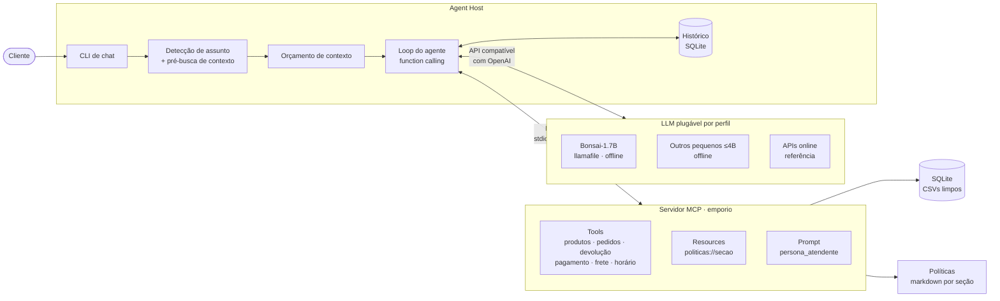

**Princípio central:** preço, estoque, prazos e status nunca saem "da cabeça" do LLM. Eles vêm de código
Python determinístico e testado, exposto via MCP. O LLM decide o que consultar e redige a resposta com a
persona da loja.

### Fluxo de uma mensagem *(planejado)*

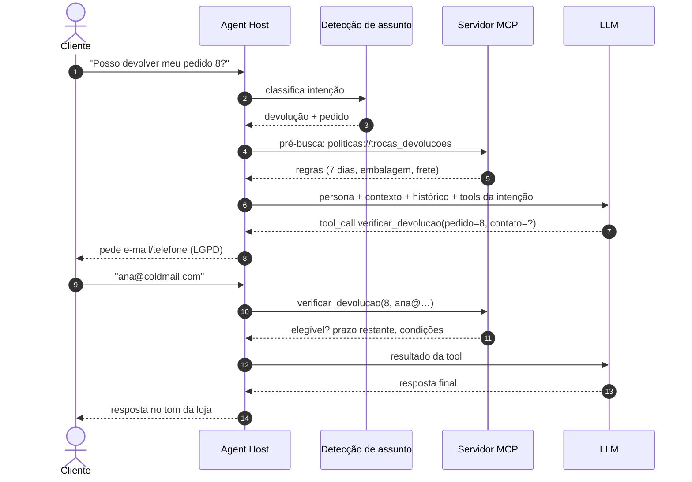

### Por que detecção de assunto *antes* do LLM

Testes com o Bonsai mostraram que modelos pequenos acertam a chamada de ferramenta só em parte dos casos.
O erro é **sistemático por tipo de pergunta**:

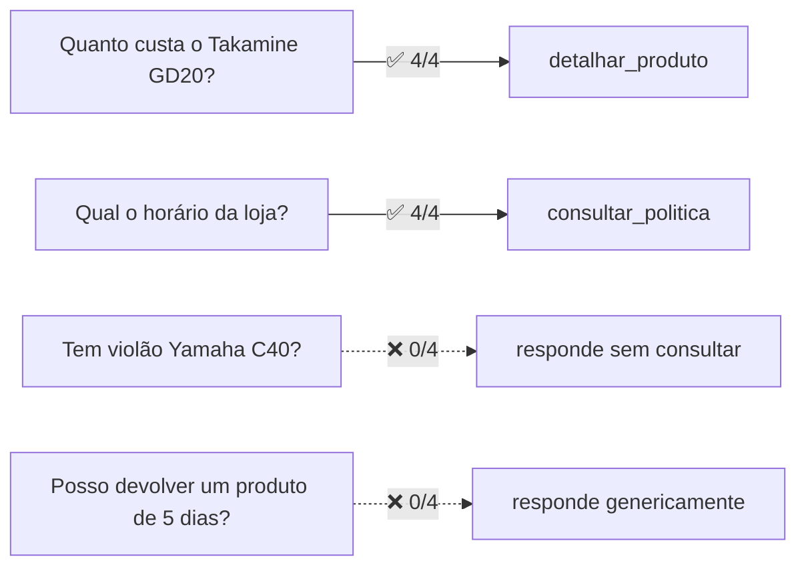

Por isso o host identifica a intenção e já injeta o contexto certo. Isso vale para **todos** os modelos,
o que deixa o comportamento previsível e a comparação justa. As tools continuam disponíveis como rede de
segurança.

### Orçamento de contexto *(planejado)*

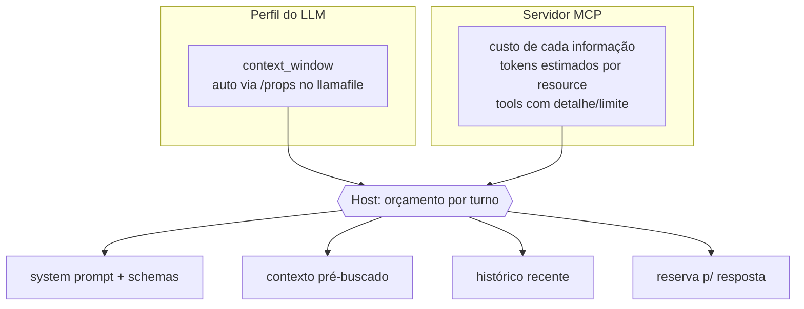

O MCP é agnóstico ao modelo (pode atender a CLI com o Bonsai em 8k e um cliente com 128k ao mesmo tempo).
Ele informa **quanto custa** cada informação, e o host decide **quanto cabe**.

---

## Pré-requisitos

Tudo está fixado. Nada depende do que "já estava instalado" na máquina.

| Ferramenta | Versão | Como instalar | Para quê |
|---|---|---|---|
| Linux/macOS x86_64 ou arm64 (ou WSL2) | — | — | runtime llamafile em CPU |
| `bash`, `curl`, `sha256sum` | qualquer recente | gerenciador de pacotes do SO (`apt install curl coreutils`) | setup e downloads |
| [uv](https://docs.astral.sh/uv/) | **0.12.21** (≥ 0.12) | `curl -LsSf https://astral.sh/uv/0.12.21/install.sh \| sh` | Python e dependências |
| Python | **3.12.14**, gerenciado pelo uv (`.python-version`) | automático no setup | — |
| Dependências Python | travadas em `uv.lock` | `uv sync --locked` (automático) | — |
| Runtime llamafile | **0.10.6** *thin*, SHA-256 em `models/manifest.tsv` | `./scripts/download_model.sh llamafile-0.10.6` (automático) | servidor do LLM local |
| Modelo Bonsai-1.7B | GGUF oficial PrismML, SHA-256 em `models/manifest.tsv` | `./scripts/download_model.sh bonsai-1.7b` (automático) | LLM baseline |
| Modelo de embeddings | embeddinggemma-300m (GGUF via `ggml-org`), SHA-256 em `models/manifest.tsv` | `./scripts/download_model.sh embeddinggemma-300m` (automático) | busca semântica |

> Prefira o instalador oficial do uv. A versão via **snap** às vezes encerrava com código 120 sem repassar o
> stdout durante o desenvolvimento.

## Setup

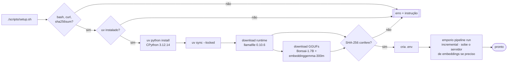

```bash
./scripts/setup.sh                 # tudo (~630 MB de download na primeira vez)
SKIP_MODEL=1 ./scripts/setup.sh    # sem runtime/modelo local (ex.: usar só API online)
```

## Como rodar

```bash
./scripts/start_llamafile.sh         # terminal 1: Bonsai-1.7B em http://127.0.0.1:8080/v1 (modelo "bonsai")
MODE=embedding ./scripts/start_llamafile.sh   # (opcional) embeddings em http://127.0.0.1:8081/v1
uv run python scripts/smoke_llm.py   # terminal 2: chat simples + chamada de ferramenta
```

`start_llamafile.sh` aceita variáveis de ambiente: `MODE` (`chat` ou `embedding`), `MODEL`, `ALIAS`, `PORT`,
`CTX`, `THREADS`, `GPU` (chat: `auto`; embedding: `disable`) e `REASONING` (`off` por padrão, só no chat).

```bash
uv run emporio pipeline run            # pipeline de dados (pula o que está em dia)
uv run emporio pipeline status         # estado de cada etapa
uv run emporio pipeline graph          # DAG em Mermaid
uv run emporio policies list           # seções do manual de políticas publicadas
uv run emporio policies search "posso devolver?"   # seção mais relevante para a pergunta
uv run emporio search "violão pra ligar na caixa de som" [--kind product|policy]   # busca híbrida
uv run emporio catalog search "Quais violões custando até R$1000?" [--all]   # filtros inferidos + preço
uv run emporio catalog show "Quanto custa o Takamine GD20?"                  # detalhe / alternativas
uv run emporio order show 8 --contato "(67) 99654-7821"                      # pedido (verificação LGPD)
uv run emporio order return 7 --contato leticia.rocha@jmail.com --motivo "veio com defeito"
uv run emporio rules pay 599.90 --parcelas 10      # PIX, débito, boleto e parcelamento válido
uv run emporio rules ship 349.90 --cidade "Campo Grande"
uv run emporio rules hours                         # aberta/fechada agora (fuso de Campo Grande)
uv run emporio mcp                                 # servidor MCP via stdio (para agentes e Claude Desktop)
uv run emporio mcp --http --port 8000              # servidor MCP via Streamable HTTP em /mcp
```

> Chat, servidor MCP e avaliação serão documentados aqui conforme forem implementados.

## Verificação (testes e CI)

Cada push reproduz o setup **do zero numa máquina limpa** (GitHub Actions, Ubuntu 24.04) e roda a mesma
verificação disponível localmente. É a garantia de que o projeto funciona fora da máquina de
desenvolvimento.

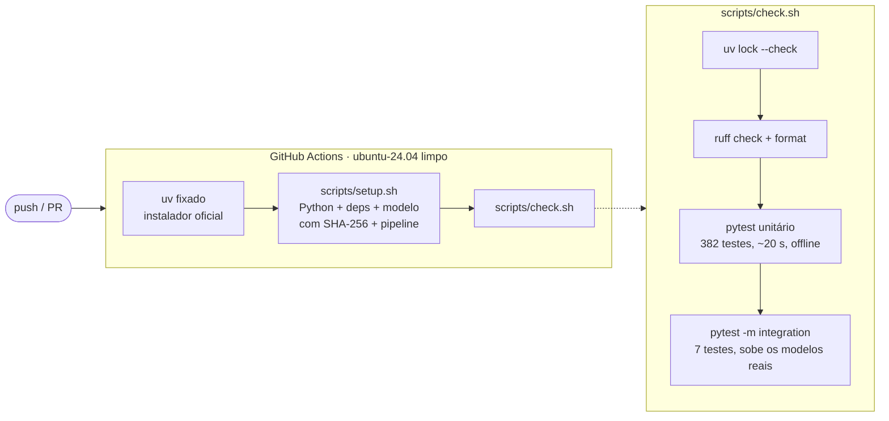

```bash
./scripts/check.sh          # tudo: lock, lint, unitários e integração (~1,5 min com os modelos baixados)
FAST=1 ./scripts/check.sh   # sem integração
uv run pytest -m integration -rs   # só a integração com o LLM local
```

| Camada | O que garante | Arquivo |
|---|---|---|
| Qualidade de código | [ruff](https://docs.astral.sh/ruff/) com ~30 famílias de regras: correção (`F`, `B`, `PL`), **segurança** (`S`/bandit), exceções (`TRY`, `BLE`), pytest (`PT`), pathlib (`PTH`), datas com fuso (`DTZ`), estilo de docstring (`D`, Google) e formatação. Exceções justificadas uma a uma no `pyproject.toml` | `pyproject.toml` |
| Versões fixadas | Python exato e gerenciado, `requires-python`, uv no setup e no README, `uv.lock` atualizado; todo artefato do manifesto é baixado pelo setup | `tests/test_infra.py` (33 testes nas 5 linhas de infraestrutura) |
| Manifesto | URLs fixadas em tag/commit (nunca `main`/`latest`), SHA-256 válido, artefatos baixados íntegros | `tests/test_infra.py` |
| Download | baixa, é idempotente, **recusa checksum errado** sem deixar lixo, não sobrescreve arquivo corrompido sem `FORCE=1` | `tests/test_infra.py` |
| Scripts | sintaxe bash válida, executáveis, erro claro sem artefatos, `MODE` inválido rejeitado, política de GPU por modo | `tests/test_infra.py` |
| `.gitignore` | binários, `.env`, `_raw/` e gerados fora do git; manifesto, `.env.example` e dados brutos dentro | `tests/test_infra.py` |
| Relatório de dados | cada número de `docs/data_report.md` continua verdadeiro sobre `data/raw` (11) | `tests/test_data_findings.py` |
| Orquestrador | ordem topológica, ciclo/dependência inexistente rejeitados, execução incremental por conteúdo, invalidação por entrada/código/versão, saída adulterada detectada, falha isola dependentes, linhagem (19) | `tests/test_pipeline_core.py` |
| Config, logs e CLI | defaults, sobrescrita por ambiente, **config inválida falha cedo**, logs texto/JSON, `emporio pipeline` e códigos de saída (12) | `tests/test_config_cli.py` |
| Camada de dados | regras de tratamento, 7 tipos de linha inválida reportados com `arquivo:linha campo`, integridade referencial, **7 violações barradas pelos `CHECK`s do banco**, banco anterior intacto quando a validação falha, mudança de regra refaz o `transform` (41) | `tests/test_data_layer.py` |
| Repository | **suíte de contrato** (22, reutilizável para o Postgres) + somente leitura, injeção de SQL, uma conexão por thread (4) | `tests/contract/`, `tests/test_sqlite_repository.py` |
| Manual de políticas | extração em seções numeradas (listas não viram seção, números não quebram), curadoria completa e em dia com o PDF, **fato ausente / seção do PDF alterada / seção sem curadoria detectados**, decisões aplicadas, busca por assunto (15 perguntas reais + 3 fora de escopo), CLI (38) | `tests/test_policies.py` |
| Catálogo | preço com promoção × PIX (§6.2), faixa de preço e categoria extraídas do texto, acessórios × "violão de 7 cordas", exemplo do enunciado ("violões até R$1000": 12 opções), preço promocional nos filtros, nome aproximado e pergunta inteira ("Quanto custa o Takamine GD20?"), ambiguidade, alternativas para esgotado/descontinuado/em breve, CLI (62) | `tests/test_catalog.py` |
| Pedidos e regras | verificação por e-mail ou telefone **do titular** (com/sem DDD, +55) e mensagem neutra em qualquer falha, e-mail duplicado só abre o próprio pedido, pedido atrasado, prazos de arrependimento/defeito/preferência dentro e fora da janela, garantia legal, parcelamento pelas faixas da §3.1, frete metropolitano × outras cidades × frete especial, feriados (Páscoa calculada) e fuso de Campo Grande, CLI (70) | `tests/test_orders_rules.py` |
| Servidor MCP | exatamente as 8 tools, todas somente leitura e com saída estruturada; nenhuma forma de listar clientes; respostas de cada tool (GD20, promoção sem PIX, alternativas, escopos, pedido verificado e não verificado, devolução, pagamento, frete, horário, políticas); erro esperado amigável, argumento inválido rejeitado, **erro inesperado sem detalhes internos**, **logs sem e-mail/telefone**; resources e prompt; transportes **stdio e HTTP** com subprocesso real (26) | `tests/test_mcp_server.py` |
| Busca | documentos (descrição suja não entra), índice vetorial, **suíte de contrato do `Retriever`** (lexical e híbrido), fusão RRF, limiar de similaridade, **degradação para lexical** (serviço fora do ar, índice vazio, modelo trocado) e recuperação, cache de vetores, etapa sem modelo, CLI (44) | `tests/test_retrieval.py`, `tests/contract/` |
| Modelos reais | **chat:** servidor sobe pelo script, contexto 8192, alias `bonsai`, responde e devolve **tool call estruturado**; **embeddings:** vetores de 768 dimensões e pergunta sem palavras em comum ("esquecer meu cadastro") mais próxima da seção certa; **busca híbrida com o modelo real** com a porta configurada ocupada por outro serviço (sobe em porta livre, acha privacidade, ignora "receita de bolo"); **encerrar o `emporio mcp` (SIGTERM ou SIGHUP) encerra o servidor de embeddings** (7) | `tests/test_llm_integration.py` |

## Pipeline de dados

Todo processamento de dados passa por um **DAG de etapas idempotentes**, executado pelo `setup.sh` e pela
CLI `emporio pipeline`. Etapas em verde já existem; as demais entram nos próximos commits.

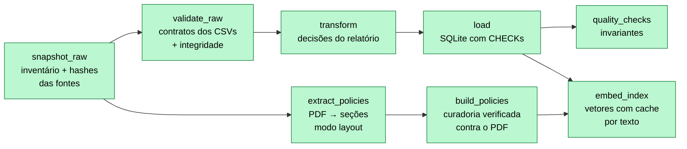

| Etapa | O que faz | Saída |
|---|---|---|
| `snapshot_raw` | Inventário das 7 fontes (hash, linhas, colunas); falha se faltar alguma | `raw_snapshot.json` |
| `validate_raw` | Contrato Pydantic por linha (tipo, domínio, formato: preço > 0, status válido, specs em JSON, rastreio `BR…BR`, parcelas 1–12…) + unicidade e integridade referencial. Reporta **todas** as falhas com `arquivo:linha campo` | `validation_report.json` |
| `transform` | Aplica as decisões do [relatório](docs/data_report.md): disponibilidade, descrição não confiável (7 itens), promoção vigente única, texto normalizado para busca, pagamento → forma + parcelas, dados mínimos do cliente | `staging/*.jsonl` |
| `load` | Cria o banco a partir do [`schema.sql`](src/emporio/data/schema.sql) numa transação única; a troca do arquivo é atômica, então um erro mantém o banco anterior | `store.db` |
| `quality_checks` | Invariantes no banco carregado (promoção coerente, nenhum pedido sem itens, descrição oculta…) + `PRAGMA integrity_check` | `quality_report.json` |
| `extract_policies` | Extrai o PDF em modo *layout* (preserva tabelas e listas), remove cabeçalho/rodapé de página e divide nas seções numeradas do manual, com hash por seção | `policies_extracted.json` / `.md` |
| `build_policies` | Valida a curadoria contra a extração (ver [Manual de políticas](#manual-de-políticas)) e publica as seções com palavras-chave e custo em tokens | `policies.json` |
| `embed_index` | Monta os 75 documentos de busca (produtos sem descrição suja + seções do manual) e grava os vetores. Reaproveita vetores de textos que não mudaram; sobe o servidor de embeddings se preciso; sem modelo, grava índice vazio e a busca fica só lexical | `vectors.db` |

**Como o orquestrador decide o que rodar:**

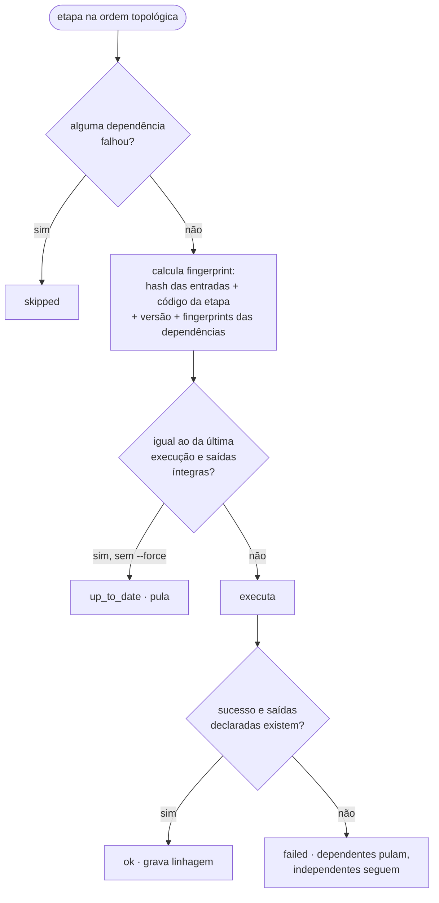

- **Incremental por conteúdo:** só refaz o que mudou. Se uma etapa refaz e gera o mesmo conteúdo, as
  seguintes continuam em dia. Mudar o código de uma etapa, ou de um módulo que ela declara usar (por exemplo
  as regras de `rules.py`), já a invalida, sem precisar mexer na versão.
- **Linhagem:** `data/processed/manifest.json` registra, por etapa, o hash de cada entrada e saída, o
  fingerprint, a duração, as métricas e o erro. Saídas adulteradas são detectadas.
- **Robusto a falhas:** o estado é salvo após cada etapa, com escrita atômica. Uma falha no meio não perde o
  progresso e não deixa estado inconsistente.
- **Portável:** cada etapa é uma função `f(ctx) -> métricas` que não depende do runner, e corresponde 1:1 a
  uma task do Airflow ou do Dagster.

## Manual de políticas

O PDF é a fonte, mas o agente consome uma **versão curada e versionada** (`data/curated/politicas/*.md`):
uma seção por tema, revisada à mão, com front matter (id, seções do PDF de origem, tipo, palavras-chave) e
**notas de curadoria** para cada decisão. O pipeline impede que curadoria e PDF se desencontrem.

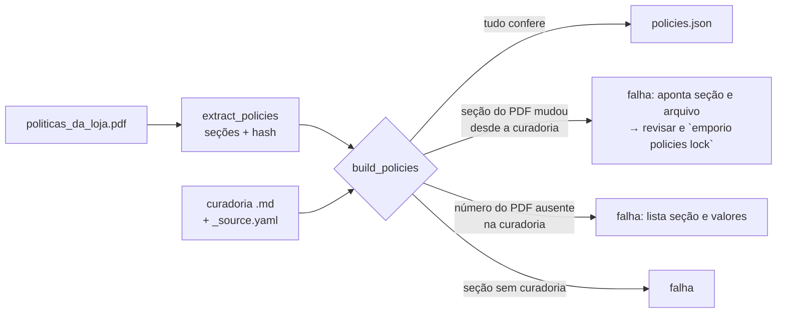

- **Nenhum fato se perde na revisão:** todo número de cada seção do PDF (prazos, valores, horários,
  telefones, leis) precisa aparecer na seção curada correspondente. Na primeira execução, essa verificação
  pegou o rodapé "Versão 2.1 / 2025", que tinha ficado de fora.
- **PDF novo não passa despercebido:** `_source.yaml` guarda o hash de cada seção usada na curadoria. Se o PDF
  mudar, o pipeline aponta exatamente quais seções e arquivos revisar.
- **Decisões explícitas** (notas de curadoria): os dois telefones com seus papéis (3341-4444 cadastral,
  3321-4500 WhatsApp), o e-mail sem acento, e a regra de parcelamento da §3.1 prevalecendo sobre a tabela.
- **Tipos:** `policy` (regra para o cliente) e `guideline` (instrução para o atendente, como tom de voz e
  fluxo). O manual inteiro tem ~3,2 mil tokens estimados, então cabe até no contexto de 8k do Bonsai.
- **Busca por assunto** (`PolicyStore.search`): determinística, por palavras-chave curadas (inclusive
  coloquiais, como "me arrependi" e "dá pra parcelar"), título e corpo. Abaixo de um limiar mínimo, não
  retorna nada, porque é melhor não pré-buscar do que pré-buscar a seção errada. É a base da detecção de
  assunto; a busca semântica entra no próximo commit.

## Busca híbrida

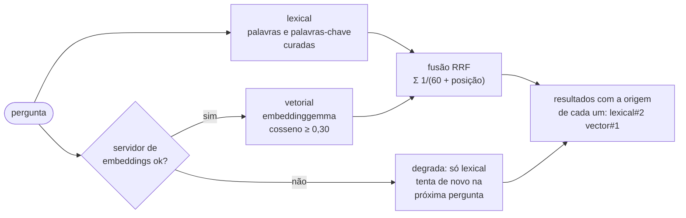

| Pergunta | Lexical sozinha | Vetorial sozinha | Híbrida |
|---|---|---|---|
| "Takamine GD20" | ✔ GD20 | ✔ GD20 | ✔ GD20 (1º nas duas) |
| "como faço pra vocês esquecerem meu cadastro?" | ✘ nada | ✔ privacidade | ✔ privacidade |
| "violão que dá pra ligar na caixa de som" | ✘ eletroacústico em 2º | ✘ eletroacústico em 6º | ✔ eletroacústico de aço em 1º |
| "violão que dá pra ligar na caixa de som, com cordas de aço" | ✘ violão sem eletrônica | ✘ violão sem eletrônica | ✘ eletroacústico em 2º |
| "receita de bolo de cenoura" | nada | nada (abaixo do limiar) | nada |

- **Degradação graciosa:** sem modelo baixado, com o serviço fora do ar ou com índice de outro modelo, a busca
  continua funcionando só com a parte lexical, e informa o motivo.
- **Explicável:** cada resultado traz a posição que teve em cada busca.
- **Limiar calibrado** com o modelo real: resultados vetoriais com similaridade abaixo de 0,30 não contam
  (ver limitações).
- `uv run emporio search "pergunta"` sobe o servidor de embeddings se preciso e o encerra ao final.

## Catálogo

`CatalogService` (`src/emporio/domain/catalog.py`) concentra as regras do catálogo. O LLM nunca calcula preço
nem decide disponibilidade: recebe o resultado pronto, com uma nota de orientação quando é preciso.

| Regra | Origem | Como fica |
|---|---|---|
| Preço promocional sempre com o original e o percentual | manual §6.2 | `R$ 5.519,08 na promoção Desconto Exclusivo (8% de desconto sobre R$ 5.999,00)` |
| PIX com 5% de desconto, **mas não sobre promoção** | §3 e §6.2 | GD20 (promoção inativa): `R$ 2.199,00 (ou R$ 2.089,05 no PIX)`; produto em promoção: sem PIX |
| Filtros pelo preço efetivo | §6.2 | Ohana CK-20 (R$ 549 com 20%) aparece em "ukulele até 450" |
| Esgotado, descontinuado ou em breve → informar e sugerir alternativas | §7.3 | Até 3 disponíveis da mesma categoria, priorizando o mesmo tipo ("Dreadnought", "7 Cordas") e preço próximo |
| A loja não vende acessórios | §1 e §7.1 | "vocês vendem cordas?", "corda de violão", "amplificador pra guitarra" → redirecionar; "violão de **7 cordas**" continua busca de instrumento |
| Categorias sem produto | relatório de dados | "tem flauta?", "quero um violino" → informar com transparência |

**Pensado para um LLM pequeno**, que pode mandar a pergunta inteira em vez de preencher os parâmetros:
- **Filtros inferidos do texto:** "Quais opções de violões disponíveis custando até R$1000?" vira categoria
  Violões + até R$ 1.000 (12 opções, ordenadas por preço). "entre 5 mil e 8.000" também é entendido.
- **Nome aproximado:** "Quanto custa o Takamine GD20?", "takamine gd 20" e "TAKAMINE GD-20" encontram o
  mesmo produto. As palavras de pedido ("quanto custa o…") são descartadas antes da comparação.
- **Ambiguidade explícita:** "takamine" e "martin d28" devolvem os candidatos e a orientação de perguntar
  qual. "Quanto custa um violão?" (categoria, não modelo) orienta a usar a busca.

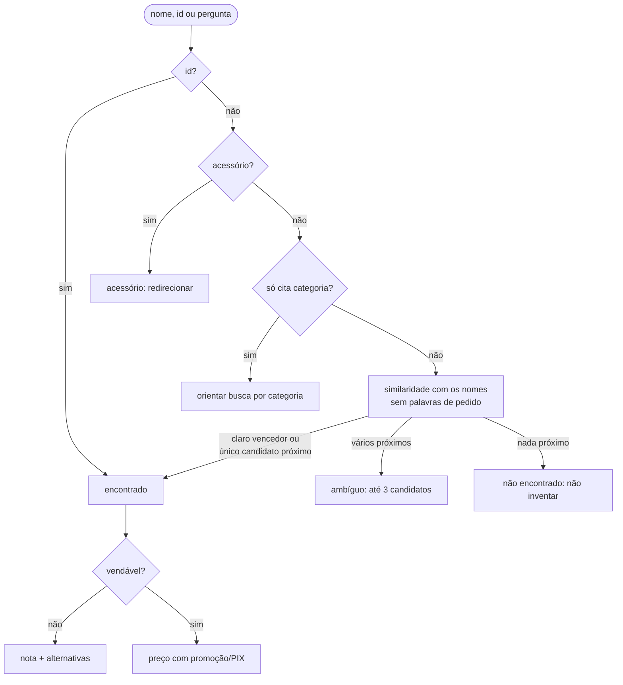

## Pedidos e regras da loja

Tudo calculado em código e testado (`src/emporio/domain/orders.py`, `calculators.py`, `store_hours.py`).
O LLM recebe a decisão pronta (elegível ou não, até quando, o que fazer em seguida) e só redige a resposta.

**Consulta de pedido (LGPD):** exige o número do pedido **e** o e-mail ou telefone do titular *daquele*
pedido. Qualquer falha (pedido inexistente, contato de outra pessoa, contato incompleto) devolve a mesma
mensagem neutra, que não revela se o pedido existe. O cliente com e-mail duplicado na base só abre o próprio
pedido.

**Troca e devolução** (manual §4 e §8), contadas a partir da `REFERENCE_DATE`:

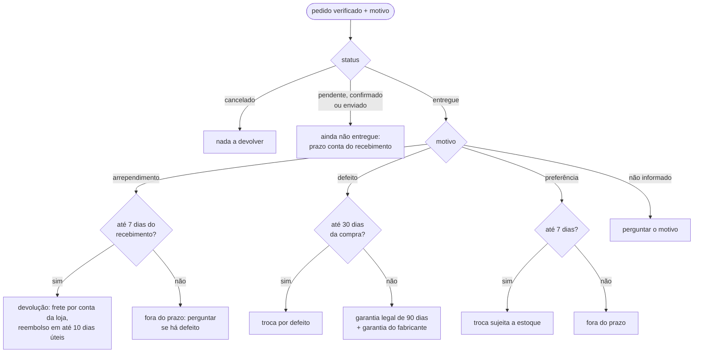

Com a data de referência padrão (25/03/2026), **nenhum pedido entregue ainda está dentro dos 7 dias de
arrependimento** (o mais recente foi entregue há 36 dias). Por isso o exemplo "me arrependi, posso
devolver?" responde "fora do prazo" e já oferece o caminho certo: o pedido 7 passou da troca por defeito,
mas a **garantia legal vale até 18/05/2026**. Os casos dentro do prazo são testados com outras datas de
referência. O pedido 8 aparece como **atrasado** (previsão de entrega vencida) e é encaminhado à equipe.

| Regra | Como fica |
|---|---|
| Pagamento (§3, §3.1) | PIX com 5% (só sem promoção), débito, boleto; parcelamento até 3x com parcela ≥ R$ 50, 4–6x ≥ R$ 80, 7–12x ≥ R$ 100. R$ 599,90 → até 6x de R$ 99,98; "10x?" é recusado com o motivo. Combinar formas só acima de R$ 2.000 |
| Frete (§5) | Campo Grande: motoboy, 1 a 3 dias úteis, grátis a partir de R$ 500 (senão R$ 35). Outras cidades: SEDEX, Jadlog e PAC com prazos e valor pelo CEP. Baterias, pianos e contrabaixos acústicos: frete especial |
| Horário (§2) | Seg–sex 09–18h, sáb 09–13h, domingo e feriados fechado, no fuso de Campo Grande. Feriados nacionais, Sexta-feira Santa (calculada a partir da Páscoa), 11/10 (MS) e 26/08 (Campo Grande). Diz quando a loja abre de novo |

## Servidor MCP (a API)

`src/emporio/mcp_server/` expõe o domínio pelo [Model Context Protocol](https://modelcontextprotocol.io)
(SDK oficial `mcp` 2.x). É uma camada fina: cada tool traduz a chamada para o domínio e devolve **saída
estruturada** com um campo `resposta` já redigido pelas regras e, quando preciso, uma `orientacao` para o
agente.

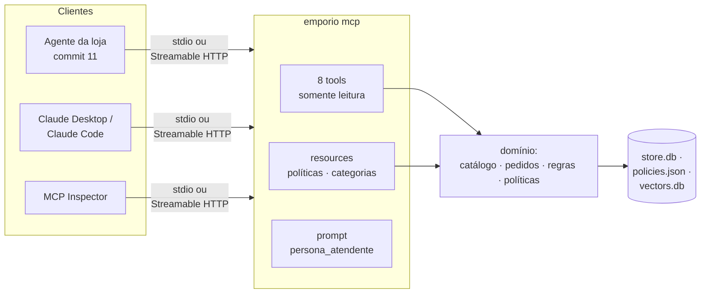

| Tool | Para quê |
|---|---|
| `buscar_produtos(texto, categoria, preco_min, preco_max, apenas_disponiveis, limite)` | opções com preço, promoção e PIX; filtros inferidos do texto |
| `detalhar_produto(produto)` | um modelo (nome aproximado, pergunta inteira ou id), com alternativas se indisponível |
| `consultar_pedido(numero_pedido, email_ou_telefone)` | status, itens, total e rastreio, **só para o titular** |
| `verificar_devolucao(numero_pedido, email_ou_telefone, motivo)` | troca/devolução pelas regras do manual |
| `simular_pagamento(valor, preco_promocional, parcelas)` | PIX, débito, boleto e parcelamento válido |
| `calcular_frete(valor_pedido, cidade, produto_ou_categoria)` | Campo Grande, outras cidades, frete especial |
| `status_loja()` | aberta ou fechada agora, próxima abertura |
| `consultar_politica(pergunta, limite)` | seções do manual relevantes (busca híbrida) |

- **Resources:** `politicas://indice` (seções com **custo estimado em tokens**, para o orçamento de contexto),
  `politicas://{secao}` e `catalogo://categorias`.
- **Prompt** `persona_atendente`: a "Mel", com o tom da §7.1 e as regras que ela nunca quebra.
- **Segurança:** todas as tools são somente leitura (anotação `read_only_hint`); nenhuma lista clientes; erros
  inesperados chegam ao cliente sem detalhes internos; os logs mascaram e-mail e telefone.
- **Ciclo de vida:** `emporio mcp` sobe o servidor de embeddings junto e o encerra ao sair, inclusive com
  SIGTERM ou terminal fechado (há teste de regressão que falha sem essa proteção).

Para usar no Claude Desktop ou no Claude Code, aponte para o comando (stdio):

```json
{
  "mcpServers": {
    "emporio": {
      "command": "uv",
      "args": ["run", "--directory", "/caminho/para/ai-engineer-challenge", "emporio", "mcp"]
    }
  }
}
```

## Camada de dados

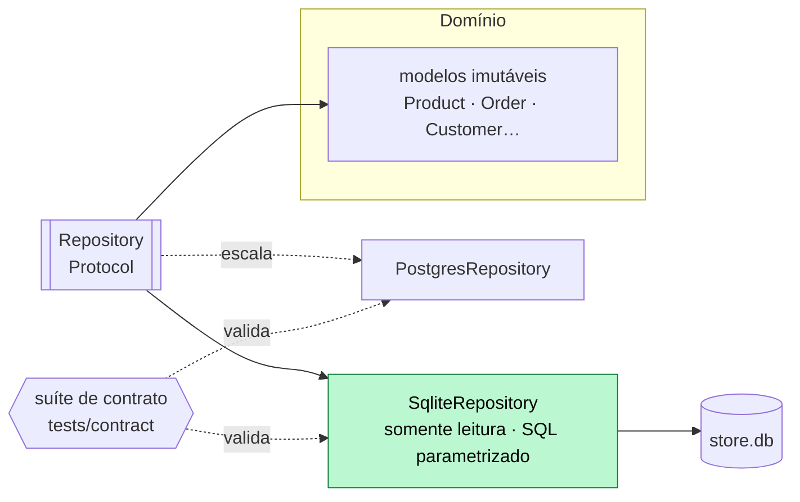

- **As regras viram restrições do banco.** Por exemplo, um produto "disponível" sem estoque, um pedido
  pendente com rastreio, uma descrição não confiável exposta ou um preço promocional acima do cheio são
  rejeitados pelo próprio SQLite (`CHECK`). Há teste para cada violação.
- **`Repository`** é a interface de leitura usada pelo domínio. **Não existe método para listar clientes**
  (LGPD): dados pessoais só são lidos pontualmente, para verificar quem consulta o próprio pedido, e o
  modelo `Customer` nem carrega o nome completo.
- **Adaptador SQLite:** conexão somente leitura, uma conexão por thread e consultas sempre parametrizadas
  (há teste de injeção).
- **Suíte de contrato** (`tests/contract/repository_contract.py`): 22 testes que qualquer adaptador precisa
  passar. É ela que vai validar o adaptador Postgres.

## Escalabilidade e robustez

O princípio é **leve por padrão, escala por configuração, mesma interface, mesmos testes**. A banca roda tudo
com um comando, sem servidores. O caminho de crescimento fica implementado e testado atrás das mesmas
interfaces.

| Peça | Padrão (1 comando, sem servidor) | Escala (por configuração) | Status |
|---|---|---|---|
| Orquestração | DAG próprio, incremental, com linhagem | Airflow/Dagster (mesmas funções de etapa) | ✅ DAG · template Airflow *(planejado)* |
| Configuração | `.env` validado na inicialização (falha cedo) | variáveis de ambiente / secret manager | ✅ |
| Logs | texto no terminal | JSON, uma linha por evento (`LOG_FORMAT=json`) | ✅ |
| Dados | SQLite somente leitura atrás de `Repository` | Postgres (mesma suíte de contrato) | ✅ SQLite · Postgres *(planejado)* |
| Busca | híbrida (lexical + vetores em SQLite, fusão RRF) atrás de `Retriever`; degrada para lexical | pgvector (mesma suíte de contrato) | ✅ híbrida · pgvector *(planejado)* |
| Embeddings | embeddinggemma-300m no runtime llamafile, em CPU, atrás de `Embedder` | API de embeddings ou GPU | ✅ |
| API | servidor MCP via stdio ou Streamable HTTP (local, sem autenticação) | MCP HTTP atrás de API gateway com OAuth, réplicas | ✅ MCP · auth *(planejado)* |
| Serviços locais | sobem sob demanda e encerram ao final (também com SIGTERM/SIGHUP); porta ocupada → porta livre; log em arquivo | serviços dedicados (systemd/containers) | ✅ |
| LLM | Bonsai-1.7B em CPU | modelos maiores, GPU ou API | ✅ baseline |

## Modelos locais

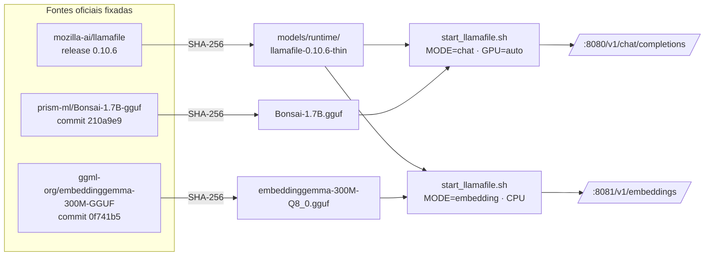

O mesmo runtime oficial serve os dois modelos. Detalhes, licenças e a política de CPU/GPU por modo:
[`models/README.md`](models/README.md).

### LLM de chat: Bonsai-1.7B

- **Bonsai-1.7B** (PrismML): arquitetura Qwen3, 1.72B params, quantização de 1 bit (~248 MB), contexto de
  treino 32k (usamos 8k).
- **Runtime e GGUF separados**, ambos de fontes oficiais com checksum. O `.llamafile` único usado no início
  do desenvolvimento é exatamente essa combinação: o GGUF embutido nele tem SHA-256 idêntico ao oficial.
- **Medições** (exploratórias, não fazem parte do CI; 4 perguntas × 2 execuções, 2 tools no prompt,
  máquina de desenvolvimento com 8 vCPU, Intel UHD 620 e NVIDIA MX150):

  | Configuração | Tool calls corretas | Tempo médio por chamada |
  |---|---|---|
  | `--reasoning off`, **CPU** (`--gpu disable`, padrão do script) | 4/8 | ~18,4 s |
  | `--reasoning off`, GPU automática (iGPU via Vulkan) | 4/8 | ~4,8–6,7 s |
  | `--reasoning on`, GPU automática | 4/8 | ~6,0 s |

  O llamafile usa a GPU automaticamente quando encontra uma. As primeiras medições foram registradas como
  "sem GPU", mas o log mostrou modo GPU; a tabela acima já está corrigida. O acerto não muda entre CPU e
  GPU, só a latência. Por isso o chat roda com `GPU=auto`: aproveita a GPU se existir e cai para CPU sem
  ela (como no CI). `GPU=disable` força CPU.

### Embeddings: embeddinggemma-300m

Escolhido numa [avaliação com 4 candidatos](docs/embeddings_eval.md) (20 perguntas com gabarito sobre os 65
produtos e as 10 seções de políticas, tudo em CPU):

| Modelo | Acerto no 1º | Acerto no top 3 | Consulta | Download | Licença |
|---|---|---|---|---|---|
| Busca lexical (atual) | 70% | 70% | ~0 ms | — | — |
| **embeddinggemma-300m** ✅ | **90%** | **95%** | **104 ms** | **334 MB** | Gemma Terms |
| bge-m3 | 85% | 95% | 170 ms | 635 MB | MIT |
| Qwen3-Embedding-0.6B | 70% | 90% | 386 ms | 639 MB | Apache-2.0 |
| nomic-embed-text-v2-moe | inviável: contexto de 512 tokens | | | 512 MB | Apache-2.0 |

O ganho real aparece em perguntas sem palavras em comum com o texto ("como faço pra vocês esquecerem meu
cadastro?" → privacidade) e em palavras ambíguas ("baixo de quatro cordas", que a busca lexical mandava para
"atendimento" por causa de *cordas*). Os embeddings rodam **sempre em CPU**: lotes grandes derrubaram o
driver da GPU integrada nos testes.
  O raciocínio não melhora o acerto nesse porte, então fica desligado.

Detalhes e como adicionar modelos: [`models/README.md`](models/README.md).

## Decisões técnicas

| Decisão | Escolha | Justificativa |
|---|---|---|
| API de negócio | **Servidor MCP** (SDK oficial `mcp` 2.x, `MCPServer`) | Separa regras de negócio da orquestração; interoperável (Claude Desktop, Inspector, llamafile); primitivas certas (tools, resources, prompts). |
| Abordagem | Function calling + **detecção de assunto com pré-busca** para todos os modelos | Dados exatos vêm de código testado; compensa a fraqueza de modelos pequenos em tool calling. |
| LLM | Cliente compatível com OpenAI, **perfis** offline/online | Um caminho de código para llamafile, Ollama, APIs. Começamos por modelos pequenos (≤ 4B). |
| Baseline | Bonsai-1.7B via llamafile 0.10.6 | Gratuito, offline, ~250 MB; usa GPU se houver, CPU se não. |
| Embeddings | **embeddinggemma-300m** no mesmo runtime, sempre em CPU | Venceu a [avaliação](docs/embeddings_eval.md) em acerto, latência e tamanho. Mesmo runtime do LLM, sem stack nova; bge-m3 (MIT) como alternativa se a licença Gemma for um impedimento. |
| Políticas | **Curadoria versionada** do PDF, verificada pelo pipeline (cobertura, versão do PDF, fatos), publicada por seção | O manual tem ~3,2 mil tokens; vector DB seria desproporcional. A revisão humana resolve as contradições do PDF, e a verificação automática garante que ela não perde nem desatualiza nada. |
| Dados | CSV → validação → limpeza → **SQLite** (atrás de uma interface `Repository`) | Vem com o Python (zero dependência nova), um arquivo só, esquema com restrições que registram as decisões do relatório, SQL com parâmetros, mesmo motor para o histórico. Com 65 produtos, um servidor seria desproporcional; Postgres entra como adaptador de escala. |
| Busca | **Híbrida**: lexical + vetorial com fusão RRF, atrás da interface `Retriever` | A lexical acerta nomes exatos ("Takamine GD20"); a vetorial resolve perguntas sem palavras em comum ("esquecer meu cadastro"); a fusão às vezes acerta o que nenhuma das duas acerta sozinha (e às vezes não: ver a tabela em [Busca híbrida](#busca-híbrida)). Vetores em SQLite com busca exata em memória: com 75 documentos, um banco vetorial não se paga. **pgvector** fica como adaptador de escala, validado pela mesma suíte de contrato. |
| Orquestração | **DAG próprio** (`emporio pipeline`), sem Airflow | Não há nada para agendar (dados estáticos, processados em menos de 1 s). Airflow exigiria scheduler, webserver e banco de metadados. Cada etapa corresponde 1:1 a uma task do Airflow quando houver sync com um sistema real. |
| Reprodutibilidade | uv + `uv.lock` + Python gerenciado + manifesto SHA-256 | A equipe avaliadora reproduz o ambiente idêntico. |

## Tratamento de dados e suposições

Relatório completo, com modelo ER, gráficos e uma decisão para cada achado:
[`docs/data_report.md`](docs/data_report.md). Todos os números são recalculados por
`uv run python scripts/explore_data.py` e conferidos por testes (`tests/test_data_findings.py`).

| Achado | Decisão |
|---|---|
| 7 produtos com **nome e descrição de marcas diferentes** (135, 136, 137, 139, 140, 142, 144) | O nome é a fonte da verdade; a descrição desses itens não é usada |
| Status × estoque conflitantes: 96 (ativo, estoque 0), 136 (descontinuado, estoque 13), 130 (*coming soon*, já vendido) | O status prevalece; só `active` com estoque > 0 é vendável |
| Categorias de sopros e cordas orquestrais **sem nenhum produto** | O agente informa com transparência; nunca inventa produto |
| Promoções **sem datas**, só `is_active` (4 ativas) | `is_active` é a vigência; o PIX não se soma à promoção (manual §6.2) |
| Totais dos pedidos 3 e 20 ≠ soma dos itens | Vale o `total_brl` (valor cobrado) |
| Não há data real de entrega; os dados vão até mar/2026 | `estimated_delivery` como proxy; `REFERENCE_DATE=2026-03-25` define o "hoje" |
| Regras ambíguas no manual | Exatos R$ 500 → frete grátis (favorece o cliente); até 3x, parcela ≥ R$ 50; troca por preferência conta do recebimento; região metropolitana = Campo Grande (únicos clientes da região na base); Carnaval e Corpus Christi não fecham a loja (pontos facultativos); cancelamento antes da entrega vai para a equipe (o manual não trata) |
| E-mail duplicado (clientes 11 e 43) | Verificação por **pedido + e-mail/telefone do titular daquele pedido** (LGPD) |
| PDF: 2 telefones, e-mail com e sem acento, regras de parcelamento contraditórias; extração com ~1 palavra por linha | Regra mais específica prevalece; extração em modo layout + [curadoria versionada e verificada](#manual-de-políticas) |

## Roadmap

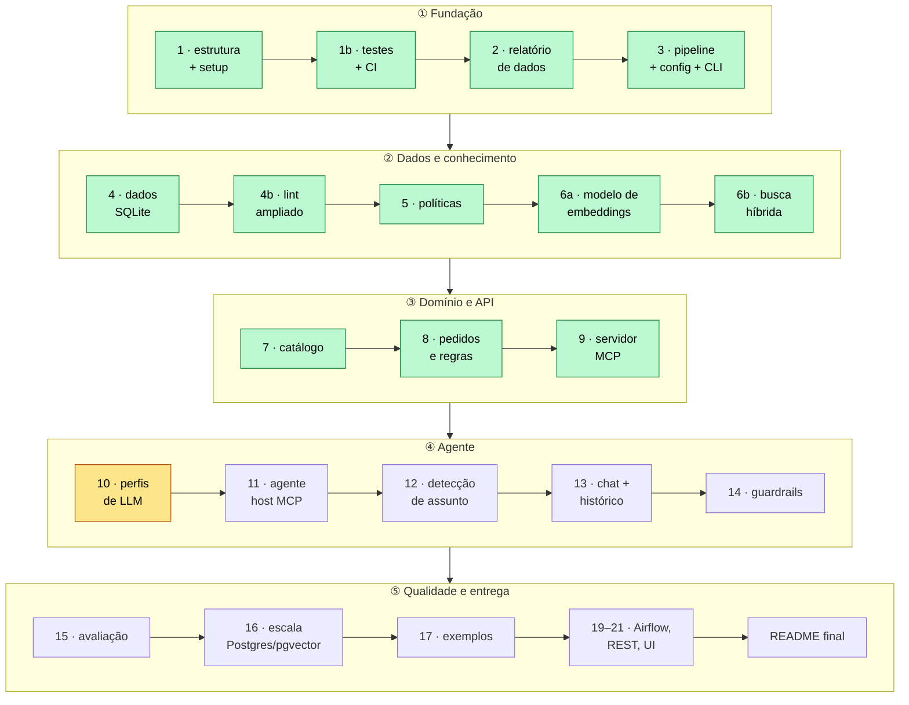

Verde: concluído. Amarelo: próximo. Os extras (19–21: endpoint REST `/chat`, interface gráfica e template de
DAG do Airflow) entram antes do README final.

## Estrutura do repositório

```
config/          perfis de LLM                                   (planejado)
data/raw/        CSVs e manual de políticas originais
data/curated/    curadoria do manual (uma seção .md por tema + _source.yaml) — versionada
data/processed/  artefatos gerados (SQLite, policies.json, extração do PDF) — não versionado
docs/            relatório de dados (data_report.md), avaliação de embeddings (embeddings_eval.md/.json);
                 workflow com IA (planejado)
evals/           cenários e resultados por modelo                 (planejado)
examples/        conversas de exemplo                             (planejado)
models/          manifest.tsv (versionado) + binários (não versionados)
scripts/         setup, verificação (check.sh), download de modelos, start do llamafile, smoke test,
                 exploração dos dados (explore_data.py), avaliação de embeddings (eval_embeddings.py)
src/emporio/     config.py (configuração validada), log.py (logs estruturados), cli.py (emporio),
                 pipeline/ (orquestrador + etapas), data/ (contratos, regras, schema.sql, policies.py),
                 ports.py (interfaces), adapters/ (SQLite, embedders, índice vetorial, buscas),
                 retrieval/ (documentos, montagem da busca), services.py (servidores locais),
                 domain/ (modelos, busca de políticas, catálogo, pedidos, pagamento/frete, horário),
                 mcp_server/ (servidor MCP, saídas estruturadas, persona); agente (planejado)
tests/contract/  suítes de contrato reutilizáveis por adaptador
tests/           testes automatizados (unitários + integração com o LLM local)
.github/         CI (GitHub Actions)
```

## Limitações conhecidas

- O baseline 1.7B em CPU é lento (~18 s por chamada em média; ~5 s com GPU) e acerta tool calling só em parte dos casos. A detecção
  de assunto mitiga isso, mas não elimina.
- O limiar de similaridade separa pouco: no conjunto de avaliação, a resposta certa menos parecida teve 0,313
  e a pergunta fora de escopo mais parecida, 0,292 (limiar 0,30). Ele é um filtro auxiliar; a defesa principal
  contra perguntas fora de escopo será a detecção de assunto e os guardrails.
- Indexar os 75 documentos em CPU leva ~1 minuto na primeira vez (depois, só o que muda é recalculado).
- O valor do frete para outras cidades não é calculado (depende de CEP, peso, dimensões e APIs das
  transportadoras); o agente informa os prazos e que o valor sai no fechamento.
- O servidor MCP via HTTP não tem autenticação: escuta só em `127.0.0.1` por padrão. Em produção, ficaria
  atrás de um gateway com OAuth (o SDK já oferece suporte).
- A verificação de identidade aceita o telefone sem DDD (8+ dígitos finais): é prática para o cliente, mas
  mais fraca que um código por SMS/e-mail (OTP), que seria o próximo passo em produção.
- *(Lista completa e "o que faria com mais tempo" ao final do projeto.)*

## Uso de assistentes de código

Este projeto está sendo desenvolvido com o **Claude Code** como par de programação. Workflow, com detalhes em
`docs/ai_workflow.md` *(planejado)*:
- **Entendimento e plano:** leitura do enunciado, dos CSVs e do PDF; levantamento de inconsistências nos dados;
  plano de implementação dividido em commits, revisado e ajustado por mim antes de cada etapa.
- **Validação empírica antes de decidir:** testes de viabilidade do modelo local (tool calling, A/B de
  `--reasoning`) e verificação da procedência do modelo por checksum.
- **Decisões minhas:** uso de MCP, baseline Bonsai, começar por modelos pequenos, detecção de assunto para
  todos os modelos, metadados de contexto, reprodutibilidade total, e a exigência de que a solução seja
  escalável e robusta e rode inteira com um comando.
- **Revisão crítica do que a IA propõe:** por exemplo, questionei pgvector, Airflow e SQLite antes da camada
  de dados. A discussão levou à arquitetura "leve por padrão, escala por configuração".
- **Testes pegando erros reais:** os testes do orquestrador encontraram dois bugs no código gerado
  (fingerprint calculado antes de as dependências rodarem; saída sem extensão tratada como diretório),
  corrigidos antes do commit. Ao desenhar a camada de dados apareceu uma falha de projeto (mudar uma regra
  não invalidava a etapa que a usa), corrigida com a declaração de dependências de código por etapa.
- **Padrões de qualidade definidos por mim:** pedi o lint ampliado (ruff com ~30 famílias, inclusive
  segurança); cada exceção às regras está justificada. Cada commit é verificado isoladamente, não só o
  último do push.
- **Verificações que pegam o que passaria batido:** a checagem de fatos da curadoria encontrou uma omissão
  na revisão manual do PDF na primeira execução.
- **Testes e investigação pegando problemas reais na busca:** o embedder de teste aproximava tudo de tudo
  por causa de stopwords; a fusão quebrava se um resultado lexical não estivesse no índice vetorial; a
  suíte passou de 10 s para 118 s porque uma fixture de sessão subia o modelo real (corrigido para 12 s); e
  a porta 8081 desta máquina estava ocupada por outro serviço, o que levou à troca automática de porta.
- **Não confiar na memória sobre APIs:** o lock instalou o SDK `mcp` 2.x, em que `FastMCP` virou `MCPServer`
  e os campos passaram a snake_case. Antes de escrever o servidor, um protótipo validou cada recurso usado.
- **Lint e testes pegando bugs de produção no servidor MCP:** o campo `args` nos logs colidia com um
  atributo interno do `LogRecord` (quebraria na primeira chamada de tool); e encerrar o `emporio mcp` com
  SIGTERM ou fechando o terminal deixava o servidor de embeddings órfão. A correção tem teste de regressão,
  verificado falhando sem ela.
- **Olhar os dados antes de prometer o exemplo:** ao preparar as regras de devolução, o levantamento mostrou
  que nenhum pedido está na janela de arrependimento com a data de referência; o README e os exemplos
  assumem isso em vez de forçar um caso que os dados não sustentam.
- **Testar com a pergunta real, não com a ideal:** no catálogo, "Quanto custa o Takamine GD20?" (a pergunta
  do enunciado) saía ambígua, porque "quanto custa o" diluía o nome; e "quanto custa um violão?" virava três
  produtos aleatórios. Ambos corrigidos, com testes.
- **Medir antes de escolher, e corrigir o que foi publicado:** o modelo de embeddings foi escolhido por
  avaliação com gabarito, não por reputação. A investigação de uma queda revelou que o runtime usava a GPU
  integrada sem avisar, e que medições já publicadas como "sem GPU" estavam erradas; o README foi corrigido
  com nota explícita.
