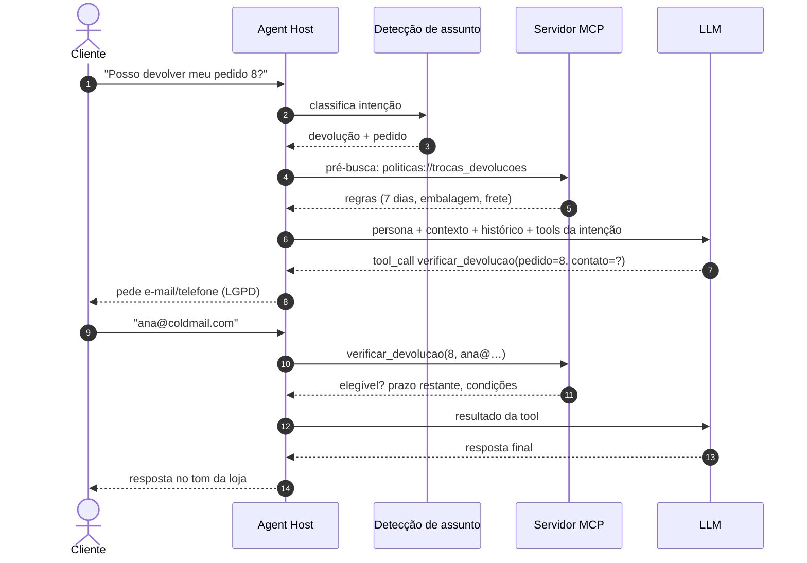
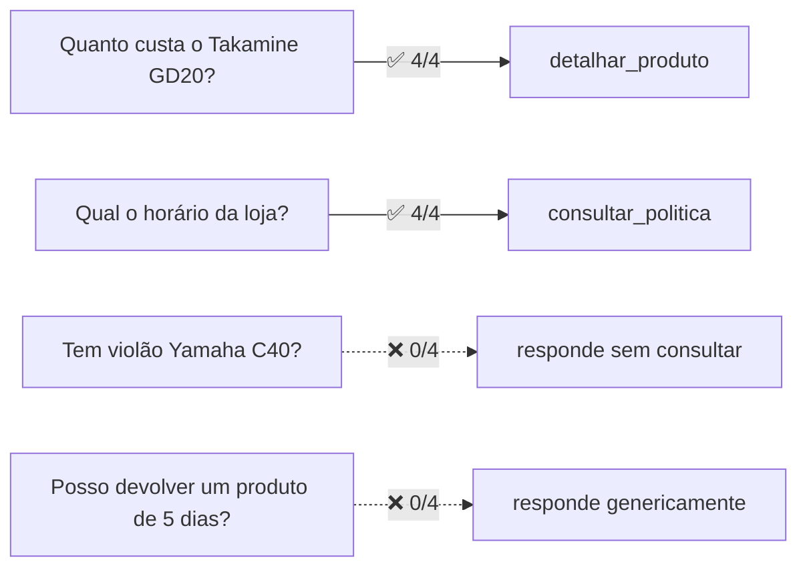
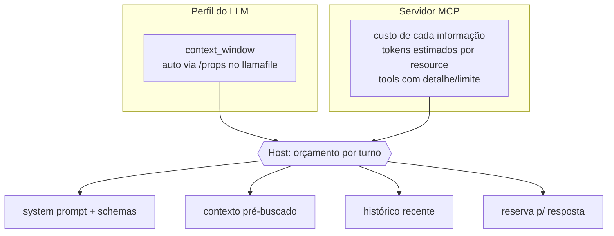
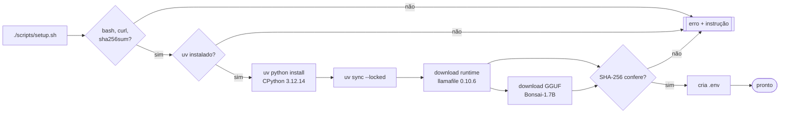
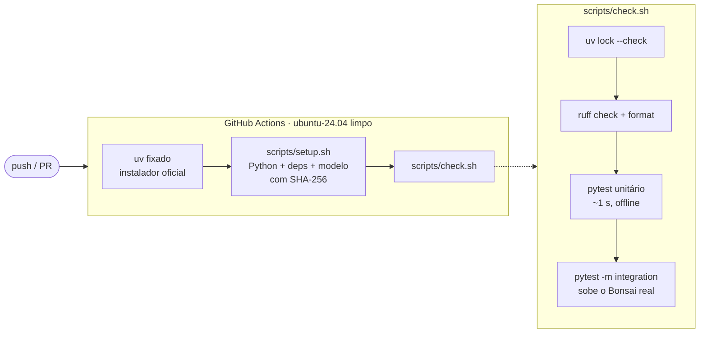
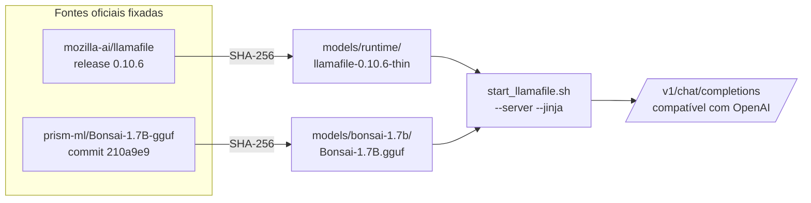

# Empório da Música — Agente de Atendimento

[](https://github.com/RonildoSilva/ai-engineer-challenge/actions/workflows/ci.yml)

Protótipo de agente de atendimento por texto para a loja fictícia **Empório da Música**, em Campo Grande/MS.
As regras de negócio ficam expostas por um **servidor MCP**. O agente conversa com **LLMs locais ou online**,
e o baseline é o `Bonsai-1.7B` rodando em CPU com o runtime oficial do llamafile.

> 🚧 **Em construção.** Status por etapa em [Roadmap](#roadmap). Diagramas marcados com *(planejado)*
> descrevem a arquitetura-alvo; o restante já existe no repositório.

---

## Sumário
- [Arquitetura](#arquitetura)
- [Pré-requisitos](#pré-requisitos)
- [Setup](#setup)
- [Como rodar](#como-rodar)
- [Verificação (testes e CI)](#verificação-testes-e-ci)
- [Modelo local (baseline)](#modelo-local-baseline)
- [Decisões técnicas](#decisões-técnicas)
- [Tratamento de dados e suposições](#tratamento-de-dados-e-suposições)
- [Roadmap](#roadmap)
- [Estrutura do repositório](#estrutura-do-repositório)
- [Limitações conhecidas](#limitações-conhecidas)
- [Uso de assistentes de código](#uso-de-assistentes-de-código)

---

## Arquitetura

### Visão geral *(planejado)*


**Princípio central:** preço, estoque, prazos e status nunca saem "da cabeça" do LLM. Eles vêm de código
Python determinístico e testado, exposto via MCP. O LLM decide o que consultar e redige a resposta com a
persona da loja.

### Fluxo de uma mensagem *(planejado)*



### Por que detecção de assunto *antes* do LLM

Testes com o Bonsai mostraram que modelos pequenos acertam a chamada de ferramenta só em parte dos casos.
O erro é **sistemático por tipo de pergunta**:



Por isso o host identifica a intenção e já injeta o contexto certo. Isso vale para **todos** os modelos,
o que deixa o comportamento previsível e a comparação justa. As tools continuam disponíveis como rede de
segurança.

### Orçamento de contexto *(planejado)*



O MCP é agnóstico ao modelo (pode atender a CLI com o Bonsai em 8k e um cliente com 128k ao mesmo tempo).
Ele informa **quanto custa** cada informação, e o host decide **quanto cabe**.

---

## Pré-requisitos

Tudo está fixado. Nada depende do que "já estava instalado" na máquina.

| Ferramenta | Versão | Como instalar | Para quê |
|---|---|---|---|
| Linux/macOS x86_64 ou arm64 (ou WSL2) | — | — | runtime llamafile em CPU |
| `bash`, `curl`, `sha256sum` | qualquer recente | gerenciador de pacotes do SO (`apt install curl coreutils`) | setup e downloads |
| [uv](https://docs.astral.sh/uv/) | **0.12.21** (≥ 0.12) | `curl -LsSf https://astral.sh/uv/0.12.21/install.sh \| sh` | Python e dependências |
| Python | **3.12.14**, gerenciado pelo uv (`.python-version`) | automático no setup | — |
| Dependências Python | travadas em `uv.lock` | `uv sync --locked` (automático) | — |
| Runtime llamafile | **0.10.6** *thin*, SHA-256 em `models/manifest.tsv` | `./scripts/download_model.sh llamafile-0.10.6` (automático) | servidor do LLM local |
| Modelo Bonsai-1.7B | GGUF oficial PrismML, SHA-256 em `models/manifest.tsv` | `./scripts/download_model.sh bonsai-1.7b` (automático) | LLM baseline |

> Prefira o instalador oficial do uv. A versão via **snap** às vezes encerrava com código 120 sem repassar o
> stdout durante o desenvolvimento.

## Setup



```bash
./scripts/setup.sh                 # tudo (~300 MB de download na primeira vez)
SKIP_MODEL=1 ./scripts/setup.sh    # sem runtime/modelo local (ex.: usar só API online)
```

## Como rodar

```bash
./scripts/start_llamafile.sh         # terminal 1: Bonsai-1.7B em http://127.0.0.1:8080/v1 (modelo "bonsai")
uv run python scripts/smoke_llm.py   # terminal 2: chat simples + chamada de ferramenta
```

`start_llamafile.sh` aceita variáveis de ambiente: `MODEL`, `ALIAS`, `PORT`, `CTX` (default 8192), `THREADS`
e `REASONING` (`off` por padrão).

> Chat completo, servidor MCP, testes e avaliação serão documentados aqui conforme forem implementados.

## Verificação (testes e CI)

Cada push reproduz o setup **do zero numa máquina limpa** (GitHub Actions, Ubuntu 24.04) e roda a mesma
verificação disponível localmente. É a garantia de que o projeto funciona fora da máquina de
desenvolvimento.



```bash
./scripts/check.sh          # tudo: lock, lint, unitários e integração (~20 s com o modelo baixado)
FAST=1 ./scripts/check.sh   # sem integração
uv run pytest -m integration -rs   # só a integração com o LLM local
```

| Camada | O que garante | Arquivo |
|---|---|---|
| Versões fixadas | Python exato e gerenciado, `requires-python`, uv no setup e no README, `uv.lock` atualizado | `tests/test_infra.py` |
| Manifesto | URLs fixadas em tag/commit (nunca `main`/`latest`), SHA-256 válido, artefatos baixados íntegros | `tests/test_infra.py` |
| Download | baixa, é idempotente, **recusa checksum errado** sem deixar lixo, não sobrescreve arquivo corrompido sem `FORCE=1` | `tests/test_infra.py` |
| Scripts | sintaxe bash válida, executáveis, erro claro sem artefatos | `tests/test_infra.py` |
| `.gitignore` | binários, `.env`, `_raw/` e gerados fora do git; manifesto, `.env.example` e dados brutos dentro | `tests/test_infra.py` |
| LLM real | servidor sobe pelo script, contexto 8192, alias `bonsai`, responde chat e devolve **tool call estruturado** | `tests/test_llm_integration.py` |

## Modelo local (baseline)



- **Bonsai-1.7B** (PrismML): arquitetura Qwen3, 1.72B params, quantização de 1 bit (~248 MB), contexto de
  treino 32k (usamos 8k).
- **Runtime e GGUF separados**, ambos de fontes oficiais com checksum. O `.llamafile` único usado no início
  do desenvolvimento é exatamente essa combinação: o GGUF embutido nele tem SHA-256 idêntico ao oficial.
- **Medições iniciais** (exploratórias, não fazem parte do CI) (CPU 8 vCPU, sem GPU, 4 perguntas × 2 execuções, 2 tools no prompt):

  | Configuração | Tool calls corretas | Tempo médio |
  |---|---|---|
  | `--reasoning off` (default) | 4/8 | ~4,8–6,7 s |
  | `--reasoning on` | 4/8 | ~6,0 s |

  O raciocínio não melhora o acerto nesse porte, então fica desligado.

Detalhes e como adicionar modelos: [`models/README.md`](models/README.md).

## Decisões técnicas

| Decisão | Escolha | Justificativa |
|---|---|---|
| API de negócio | **Servidor MCP** (SDK oficial `mcp`) | Separa regras de negócio da orquestração; interoperável (Claude Desktop, Inspector, llamafile); primitivas certas (tools, resources, prompts). |
| Abordagem | Function calling + **detecção de assunto com pré-busca** para todos os modelos | Dados exatos vêm de código testado; compensa a fraqueza de modelos pequenos em tool calling. |
| LLM | Cliente compatível com OpenAI, **perfis** offline/online | Um caminho de código para llamafile, Ollama, APIs. Começamos por modelos pequenos (≤ 4B). |
| Baseline | Bonsai-1.7B via llamafile 0.10.6 | Gratuito, offline, CPU, ~250 MB. |
| Políticas | Markdown por seção (resource MCP + tool) | Manual de ~3k tokens; vector DB seria overkill. |
| Dados | CSV → limpeza (pandas) → SQLite | Fonte única e consultável. |
| Reprodutibilidade | uv + `uv.lock` + Python gerenciado + manifesto SHA-256 | A equipe avaliadora reproduz o ambiente idêntico. |

## Tratamento de dados e suposições

*(Será detalhado em `docs/data_report.md`.)* Principais pontos já identificados:
- Produtos 135–144 com **nome e descrição divergentes**; o nome é tratado como fonte da verdade.
- Status conflitantes: 96 (ativo, estoque 0), 136 (descontinuado, estoque 13), 130 (*coming soon*, mas já vendido).
- Totais dos pedidos 3 e 20 não batem com a soma dos itens; vale o `total_brl` informado.
- Manual com dois telefones e regras de parcelamento contraditórias; a regra mais específica prevalece.
- Não há data real de entrega: `estimated_delivery` é usada como proxy. `REFERENCE_DATE` (default
  `2026-03-25`) define o "hoje" das regras de prazo.
- Consulta de pedido exige número + e-mail/telefone (LGPD).

## Roadmap

```mermaid
flowchart LR
    C1[1 · estrutura +<br/>setup reprodutível]:::done --> C1b[1b · testes +<br/>CI do setup]:::wip --> C2[2 · relatório<br/>de dados] --> C3[3 · dados<br/>SQLite] --> C4[4 · políticas] --> C5[5-6 · domínio<br/>regras] --> C7[7 · servidor<br/>MCP]
    C7 --> C8[8 · perfis<br/>de LLM] --> C9[9 · agente<br/>host MCP] --> C10[10 · detecção<br/>de assunto] --> C11[11 · CLI +<br/>histórico] --> C12[12 · guardrails] --> C13[13 · eval] --> C14[14 · exemplos] --> C15[15 · README<br/>final]
    classDef wip fill:#fde68a,stroke:#b45309,color:#000
    classDef done fill:#bbf7d0,stroke:#15803d,color:#000
```



## Estrutura do repositório

```
config/          perfis de LLM                                   (planejado)
data/raw/        CSVs e manual de políticas originais
data/processed/  artefatos gerados (SQLite, políticas .md) — não versionado
docs/            relatório de dados, workflow com IA              (planejado)
evals/           cenários e resultados por modelo                 (planejado)
examples/        conversas de exemplo                             (planejado)
models/          manifest.tsv (versionado) + binários (não versionados)
scripts/         setup, verificação (check.sh), download de modelos, start do llamafile, smoke test
src/emporio/     agente e servidor MCP
tests/           testes automatizados (unitários + integração com o LLM local)
.github/         CI (GitHub Actions)
```

## Limitações conhecidas

- O baseline 1.7B em CPU é lento (~3–14 s por chamada) e acerta tool calling só em parte dos casos. A detecção
  de assunto mitiga isso, mas não elimina.
- *(Lista completa e "o que faria com mais tempo" ao final do projeto.)*

## Uso de assistentes de código

Este projeto está sendo desenvolvido com o **Claude Code** como par de programação. Workflow, com detalhes em
`docs/ai_workflow.md` *(planejado)*:
- **Entendimento e plano:** leitura do enunciado, dos CSVs e do PDF; levantamento de inconsistências nos dados;
  plano de implementação dividido em commits, revisado e ajustado por mim antes de cada etapa.
- **Validação empírica antes de decidir:** testes de viabilidade do modelo local (tool calling, A/B de
  `--reasoning`) e verificação da procedência do modelo por checksum.
- **Decisões minhas:** uso de MCP, baseline Bonsai, começar por modelos pequenos, detecção de assunto para
  todos os modelos, metadados de contexto e reprodutibilidade total.
