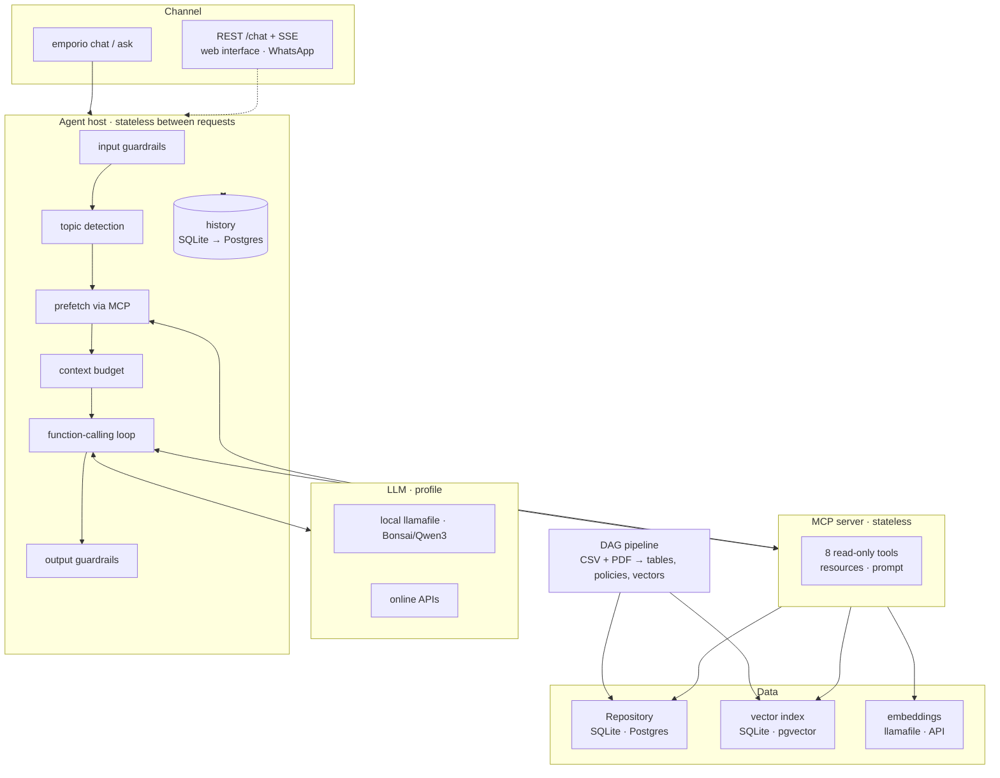

# Architecture and path to production

This document describes how the Empório da Música agent is organized and what changes to take it to
production (WhatsApp, many simultaneous conversations, live data). The project's principle is **light by default,
scale by configuration, same interface, same tests**: every scaling piece already exists behind the same
interface as the local version and passes the same test suite.

## Layers

| Layer | Local (default) | Scale | Interface / test |
|---|---|---|---|
| Store data | `store.db` (SQLite, read-only) | Postgres (`STORE_BACKEND=postgres`) | `Repository` · `tests/contract/repository_contract.py` |
| Vector index | in-memory `vectors.db` (numpy) | pgvector with HNSW (`VECTOR_BACKEND=pgvector`) | same index interface · `RetrieverContract` |
| Embeddings | local llamafile (CPU) | server replicas, GPU or API | `Embedder` · degrades to lexical if it goes down |
| API | MCP in-process or stdio | MCP via Streamable HTTP, stateless replicas | MCP protocol |
| LLM | local Bonsai/Qwen3 | GPU or API (profile) | OpenAI-compatible API · `config/llm_profiles.yaml` |
| History | `history.db` (SQLite) | Postgres (`HISTORY_BACKEND=postgres`) | `HistoryStore` · `tests/contract/history_contract.py` |
| Pipeline | own DAG, incremental | Airflow/Dagster with the same stage functions | `Stage` |

## Path to production

1. **Live data.** Today the pipeline reads the challenge's CSVs. In production, the `snapshot_raw` stage reads the ERP
   (or a read replica) and the pipeline runs on a schedule (Airflow, with the same stages). Stock and order
   status, which change every minute, become direct queries to the production Postgres through `PostgresRepository`,
   without going through the pipeline. The data handling rules remain as schema `CHECK`s.
2. **MCP server behind a gateway.** MCP over HTTP is stateless: N replicas behind a load balancer,
   with OAuth authentication at the gateway (the MCP SDK already supports it) and a per-client request limit. Connections
   to Postgres through a pool (PgBouncer).
3. **Embeddings.** The load test shows that the MCP bottleneck is the embeddings server, a CPU
   process: without the semantic searches, throughput rises ~4×. In production: GPU replicas or an embeddings API,
   and a cache for the most frequent questions.
4. **LLM.** This is the expensive and slow part (seconds to minutes per reply on CPU). Options, per profile, without changing
   code: a dedicated GPU for the local model, or an online API. The prefetch and the context budget keep the
   prompt short (~900 tokens), which lowers the cost per message with either option.
5. **Channel.** The REST API (`emporio api`: `POST /chat`, `/chat/stream` with SSE) already runs on the same
   `ChatSession` as the CLI, and the history already has a Postgres adapter (`HISTORY_BACKEND=postgres`). What is missing is the
   WhatsApp adapter (provider webhook → `POST /chat`), with the session identified by the customer's hashed phone number,
   and authentication at the gateway.
6. **Observability.** Logs already come out as JSON, one line per event (`LOG_FORMAT=json`), with topic, tools,
   tokens, latency and the reason for the safe fallback reply. In production: centralized collection, metrics for the rate of
   safe fallback replies and of hand-offs to the store team, and the evaluation (`emporio eval`) running on every prompt
   or model change.
7. **Security and LGPD.** Read-only tools, order holder verification for orders, no tool lists customers,
   email and phone masked in the history and in the logs, read-only database connections. Next step: a code
   by SMS/email (OTP) in the verification, instead of the phone number without area code.

## What was measured

| Measure | Result | Where |
|---|---|---|
| End-to-end scenarios | Qwen3-1.7B 18/18 · Bonsai 16/18 · oracle 18/18 | `evals/resultados/` |
| Intent classifier | 95% (88% on the first measurement) | `evals/resultados/` |
| Search | hybrid 90% hit@1 vs. lexical 70% | `evals/resultados/` |
| Postgres/pgvector contracts | 44 tests, ranking identical to SQLite | `tests/test_postgres.py` (CI) |
| MCP load (500 calls, 20 sessions) | 0 errors; 43–68 calls/s with semantic searches, 233–267 without | `docs/load_test/` |
