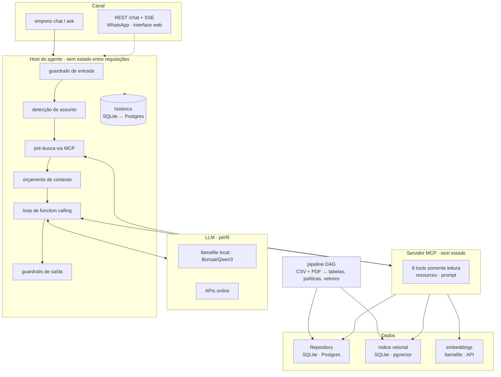

# Arquitetura e caminho de produção

Este documento descreve como o agente da Empório da Música está organizado e o que muda para levá-lo a
produção (WhatsApp, vários atendimentos simultâneos, dados vivos). O princípio do projeto é **leve por padrão,
escala por configuração, mesma interface, mesmos testes**: cada peça de escala já existe atrás da mesma
interface da versão local e passa na mesma suíte de testes.

## Camadas

| Camada | Local (padrão) | Escala | Interface / teste |
|---|---|---|---|
| Dados da loja | `store.db` (SQLite, somente leitura) | Postgres (`STORE_BACKEND=postgres`) | `Repository` · `tests/contract/repository_contract.py` |
| Índice vetorial | `vectors.db` em memória (numpy) | pgvector com HNSW (`VECTOR_BACKEND=pgvector`) | mesma interface do índice · `RetrieverContract` |
| Embeddings | llamafile local (CPU) | réplicas do servidor, GPU ou API | `Embedder` · degrada para lexical se cair |
| API | MCP em processo ou stdio | MCP via Streamable HTTP, réplicas sem estado | protocolo MCP |
| LLM | Bonsai/Qwen3 local | GPU ou API (perfil) | API compatível com OpenAI · `config/llm_profiles.yaml` |
| Histórico | `history.db` (SQLite) | Postgres (`HISTORY_BACKEND=postgres`) | `HistoryStore` · `tests/contract/history_contract.py` |
| Pipeline | DAG próprio, incremental | Airflow/Dagster com as mesmas funções de etapa | `Stage` |

## Caminho de produção

1. **Dados vivos.** Hoje o pipeline lê os CSVs do desafio. Em produção, a etapa `snapshot_raw` passa a ler o ERP
   (ou uma réplica de leitura) e o pipeline roda agendado (Airflow, com as mesmas etapas). Estoque e status de
   pedido, que mudam a todo minuto, viram consultas diretas ao Postgres de produção pelo `PostgresRepository`, sem
   passar pelo pipeline. As regras de tratamento continuam como `CHECK`s do esquema.
2. **Servidor MCP atrás de um gateway.** O MCP via HTTP não tem estado: N réplicas atrás de um balanceador,
   com autenticação OAuth no gateway (o SDK do MCP já suporta) e limite de requisições por cliente. Conexões
   ao Postgres via pool (PgBouncer).
3. **Embeddings.** O teste de carga mostra que o gargalo do MCP é o servidor de embeddings, um processo em
   CPU: sem as buscas semânticas, a vazão sobe ~4×. Em produção: réplicas com GPU ou uma API de embeddings,
   e cache das perguntas mais frequentes.
4. **LLM.** É a parte cara e lenta (segundos a minutos por resposta em CPU). Opções, por perfil, sem mudar
   código: GPU dedicada para o modelo local, ou API online. A pré-busca e o orçamento de contexto mantêm o
   prompt curto (~900 tokens), o que reduz custo por mensagem em qualquer opção.
5. **Canal.** A API REST (`emporio api`: `POST /chat`, `/chat/stream` com SSE) já roda sobre a mesma
   `ChatSession` da CLI, e o histórico já tem adaptador Postgres (`HISTORY_BACKEND=postgres`). Falta o adaptador
   do WhatsApp (webhook do provedor → `POST /chat`), com a sessão identificada pelo telefone do cliente em hash,
   e autenticação no gateway.
6. **Observabilidade.** Os logs já saem em JSON, uma linha por evento (`LOG_FORMAT=json`), com assunto, tools,
   tokens, latência e motivo da resposta de segurança. Em produção: coleta centralizada, métricas de taxa de
   resposta de segurança e de encaminhamento à equipe, e a avaliação (`emporio eval`) rodando a cada mudança de
   prompt ou de modelo.
7. **Segurança e LGPD.** Tools somente leitura, verificação do titular para pedidos, nenhuma tool lista clientes,
   e-mail e telefone mascarados no histórico e nos logs, conexões ao banco somente leitura. Próximo passo: código
   por SMS/e-mail (OTP) na verificação, em vez do telefone sem DDD.

## O que foi medido

| Medida | Resultado | Onde |
|---|---|---|
| Cenários de ponta a ponta | Qwen3-1.7B 18/18 · Bonsai 16/18 · oráculo 18/18 | `evals/resultados/` |
| Classificador de intenção | 95% (88% na 1ª medição) | `evals/resultados/` |
| Busca | híbrida 90% hit@1 × lexical 70% | `evals/resultados/` |
| Contratos Postgres/pgvector | 44 testes, ranking idêntico ao SQLite | `tests/test_postgres.py` (CI) |
| Carga no MCP (500 chamadas, 20 sessões) | 0 erros; 43–68 chamadas/s com buscas semânticas, 233–267 sem | `docs/load_test/` |
