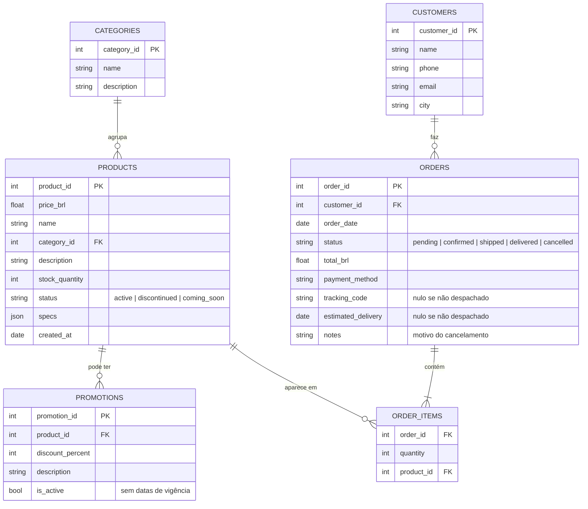
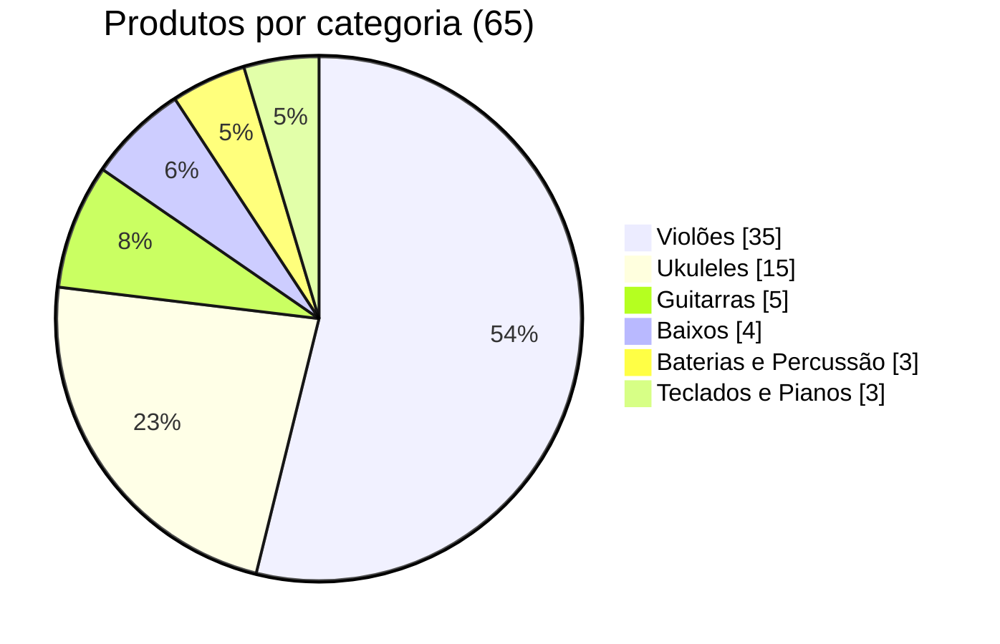
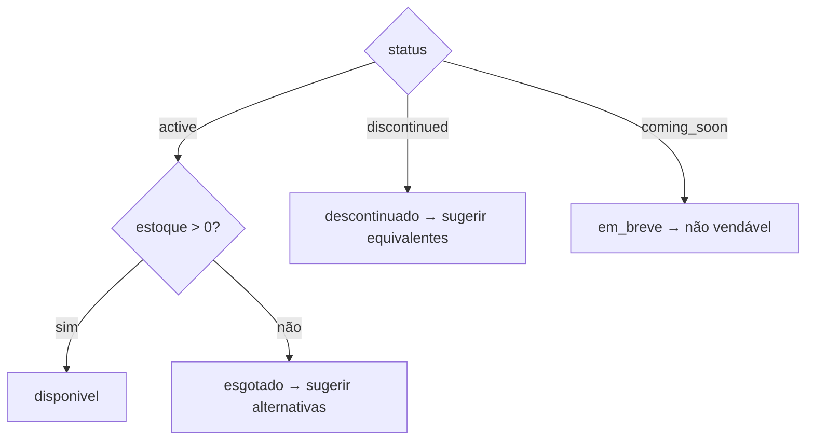
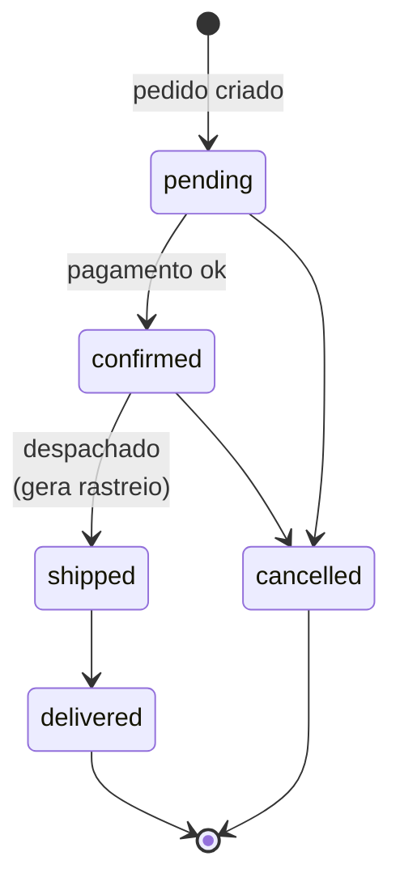

# Relatório de exploração dos dados

Análise dos materiais fornecidos pela loja (`data/raw/`) antes de qualquer implementação. Cada número
deste documento é recalculado por um script (somente leitura):

```bash
uv run python scripts/explore_data.py
```

Para cada achado há uma **decisão** de tratamento. As decisões viram regras na camada de dados (commit 3)
e nas políticas (commit 4).

---

## 1. Modelo de dados



| Tabela | Linhas | Nulos |
|---|---|---|
| `categories` | 9 | — |
| `products` | 65 | — |
| `promotions` | 25 | — |
| `customers` | 50 | — |
| `orders` | 20 | `tracking_code` 12, `estimated_delivery` 12, `notes` 16 (todos coerentes com o status) |
| `order_items` | 22 | — |

Integridade referencial: todas as chaves estrangeiras resolvem. Não há promoção de produto inexistente
nem pedido de cliente inexistente.

---

## 2. Catálogo

### 2.1 Cobertura por categoria



- **Sopros (madeiras), Sopros (metais) e Cordas Orquestrais não têm nenhum produto**, embora existam como
  categorias e o manual cite itens delas (boquilhas, contrabaixos acústicos).
  **Decisão:** o agente diz com transparência que no momento não há itens dessas categorias no catálogo.
  Nunca inventa produto.
- Preços vão de R$ 159,90 (ukulele) a R$ 19.567,00 (teclado Nord). `specs` é JSON válido em 100% dos
  produtos, com chaves que variam por tipo de instrumento (`top`, `strings`, `shells`, `polyphony`…).
- Os IDs não estão ordenados no arquivo (o 145 aparece antes do 131). Isso não tem impacto.

### 2.2 Status × estoque

| ID | Produto | Status | Estoque | Problema | Decisão |
|---|---|---|---|---|---|
| 96 | Giannini GF-3D Dreadnought Sunburst | `active` | 0 | ativo sem estoque | "Temporariamente indisponível" + alternativas da mesma categoria e faixa de preço (manual §7.3) |
| 113 | Shelby SN-7C 7 Cordas Nylon | `discontinued` | 0 | — | "Não faz mais parte do catálogo" + equivalentes (§7.3) |
| 130 | Kala KA-ABP-CTG Barítono Cedar | `coming_soon` | 2 | tem estoque e **já foi vendido** (pedidos 3 e 14) | Tratar como "em breve", não vendável. Pedidos existentes continuam consultáveis |
| 136 | Ibanez Bass 2X Electric Bass | `discontinued` | 13 | descontinuado com estoque | O **status prevalece**: fora de catálogo. O estoque residual não é ofertado |

**Regra de disponibilidade derivada:**



### 2.3 Nome × descrição divergentes

Em **7 produtos**, a marca citada na descrição é diferente da marca do nome:

| ID | Nome | A descrição fala de |
|---|---|---|
| 135 | Music Man Bass 1X Electric Bass | Fender Jazz Bass |
| 136 | Ibanez Bass 2X Electric Bass | (Fender) Precision |
| 137 | Yamaha Bass 3X Electric Bass | Ibanez 5 cordas |
| 139 | Bateria Acústica Yamaha Kit 1 Studio | Pearl Export |
| 140 | Bateria Acústica Pearl Kit 2 Studio | Tama |
| 142 | Teclado Sintetizador Korg Synth 1 Pro | Roland workstation |
| 144 | Teclado Sintetizador Roland Synth 3 Pro | Yamaha arranjador |

Os produtos 138, 141 e 143 e todas as guitarras são consistentes.
**Decisão:** o `name` é a fonte da verdade, porque é o que aparece em pedidos e no que o cliente pesquisa.
Nesses 7 itens a descrição é marcada como não confiável e não é usada nas respostas. O agente informa só
nome, preço, disponibilidade e specs. O caso fica documentado como problema de qualidade de dados da loja.

---

## 3. Promoções

- 25 promoções, **só 4 ativas**:

  | Produto | Desconto | Campanha | Preço | Preço promocional |
  |---|---|---|---|---|
  | 127 Kalani KAL-700T Tenor | 10% | Oferta Especial | R$ 359,00 | R$ 323,10 |
  | 121 Ohana CK-20 Concert | 20% | Desconto Exclusivo | R$ 549,00 | R$ 439,20 |
  | 90 Crafter HT-100 Folk | 18% | Desconto Exclusivo | R$ 2.399,00 | R$ 1.967,18 |
  | 94 Taylor 110e Dreadnought | 8% | Desconto Exclusivo | R$ 5.999,00 | R$ 5.519,08 |

- **Não há datas de vigência.** Só existe `is_active`. **Decisão:** `is_active` é a única fonte de
  vigência. Promoção inativa nunca é oferecida; se o cliente perguntar por ela, o agente informa que expirou
  e mostra o preço atual (manual §7.3).
- Os produtos 93, 96 e 99 têm duas promoções cada, todas inativas. **Decisão:** se houver mais de uma
  ativa para o mesmo produto, vale a de maior desconto (as promoções não são cumulativas, §6.2). Hoje
  isso não ocorre.
- Regras do manual aplicadas por código, não pelo LLM: preço promocional sempre exibido com o original e
  o percentual (§6.2), e o **desconto PIX de 5% não se aplica sobre preço promocional** (§6.2).
- O exemplo do enunciado, "Quanto custa o Takamine GD20?" (ID 95), tem promoção **inativa** (12%,
  Oferta Especial). A resposta correta é o preço cheio, R$ 2.199,00.

---

## 4. Pedidos



| Status | Pedidos | Com rastreio |
|---|---|---|
| delivered | 7 | 7 |
| shipped | 1 | 1 |
| confirmed | 4 | 0 |
| pending | 4 | 0 |
| cancelled | 4 | 0 (com motivo em `notes`) |

Período: **2025-10-15 a 2026-03-22**. Os 8 códigos de rastreio seguem o formato do manual §5.3
(`BR` + 9 alfanuméricos + `BR`).

| Achado | Decisão |
|---|---|
| Pedidos **3** (R$ 3.450 × itens R$ 3.498) e **20** (R$ 1.400 × itens R$ 1.488): o total não bate com a soma dos itens | Provável desconto não registrado. O agente informa o `total_brl`, o valor cobrado, e não recalcula |
| Não existe data **real** de entrega, só `estimated_delivery` | É usada como proxy da data de recebimento para o prazo de arrependimento (7 dias, §4.1) e o de defeito (30 dias, §4.2) |
| Os dados terminam em março/2026 | `REFERENCE_DATE` (default `2026-03-25`, no `.env`) define o "hoje" das regras de prazo. Com a data real, todos os pedidos estariam fora de prazo e os `pending` pareceriam abandonados |
| `payment_method` codifica parcelas (`credit_6x`, `credit_12x`) | Normalizar em forma + nº de parcelas |

---

## 5. Clientes e privacidade

- 50 clientes: Campo Grande (24), Dourados (7), Três Lagoas (7), Corumbá (6) e Ponta Porã (6). A cidade
  define a regra de frete (região metropolitana × outras cidades, §5).
- **E-mail duplicado:** `bruno.martins@jmail.com` pertence aos clientes 11 e 43, com telefones diferentes.
  **Decisão:** a verificação de identidade usa **número do pedido + e-mail ou telefone**, e o par precisa
  bater com o cliente *daquele pedido*. Assim o e-mail duplicado não gera ambiguidade.
- **LGPD (§9):** nenhuma ferramenta lista clientes ou devolve dados pessoais de terceiros. Na resposta, o
  agente usa no máximo o primeiro nome do cliente verificado.

---

## 6. Manual de políticas (PDF)

**Extração:** o `pypdf` devolve cerca de uma palavra por linha (3.5 mil linhas para 8 páginas) e quebra até
números (`3341\n-\n4444`). **Decisão:** o PDF será convertido em markdown por seção, com normalização
automática e **revisão manual**, porque as tabelas também se perdem na extração (commit 4).

Contradições encontradas:

| Tema | Trechos | Decisão |
|---|---|---|
| Telefone/WhatsApp | Capa e §1.2: **(67) 3341-4444**. §7: WhatsApp **(67) 3321-4500** | 🔧 A definir: informar o número cadastral da §1.2 ou os dois, cada um com seu papel |
| E-mail | Capa: `contato@emporiodamusica.com.br`. §1.2: `contato@empóriodamusica.com.br` (com acento) | Usar sem acento (domínios com acento são incomuns; provável erro de digitação) |
| Parcelamento | Tabela §3: "até 12x, parcela mínima R$ 100". §3.1: até 3x sem mínimo (exceto < R$ 50), 4–6x com mínimo R$ 80, 7–12x com mínimo R$ 100 | A §3.1 prevalece por ser a regra mais específica |
| Escopo | §1: "não comercializamos acessórios". §4.4 cita boquilhas | Boquilhas como parte do instrumento; acessórios avulsos (cordas, cabos, pedais…) são redirecionados (§7.1) |

---

## 7. Resumo das suposições

1. `name` é a fonte da verdade do produto. A descrição dos 7 itens divergentes é ignorada.
2. O `status` prevalece sobre o estoque. Só `active` com estoque > 0 é vendável.
3. `is_active` é a única vigência das promoções.
4. `total_brl` é o valor cobrado do pedido.
5. `estimated_delivery` é a data de recebimento, e `REFERENCE_DATE` é o "hoje".
6. Para regras conflitantes do manual, vale a mais específica.
7. A identidade é verificada por número do pedido + e-mail ou telefone do titular.
