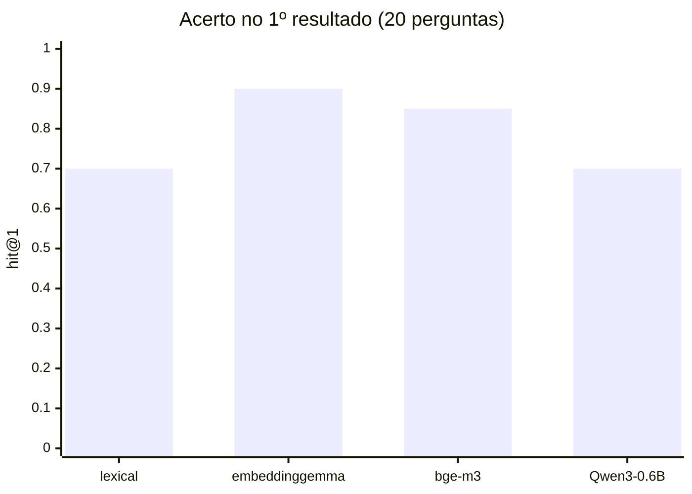

# Avaliação de modelos de embeddings

Antes de adicionar busca semântica, testamos se ela compensa e qual modelo usar. A avaliação roda
localmente, em CPU, com o mesmo runtime do LLM (llamafile 0.10.6, modo `--embedding`).

- Script: [`scripts/eval_embeddings.py`](../scripts/eval_embeddings.py)
- Resultados brutos: [`embeddings_eval.json`](embeddings_eval.json)

## Metodologia

- **Corpus:** os 75 documentos que o agente consulta: 65 produtos (nome, categoria, especificações e
  descrição apenas quando confiável) e as 10 seções curadas do manual de políticas.
- **Perguntas:** 20, com gabarito conferido nos dados:
  - 10 sobre produtos, **vagas de propósito**, sem nome de modelo: "violão que dá pra ligar na caixa de som,
    com cordas de aço", "ukulele pequeno para uma criança";
  - 10 sobre políticas, com **pouca sobreposição de palavras** com o manual: "como faço pra vocês
    esquecerem meu cadastro?", "o pacote chegou amassado, o que eu faço?".
- **Métricas:** acerto no 1º resultado (hit@1), acerto entre os 3 primeiros (hit@3), MRR, latência por
  consulta, tempo de indexação e memória.
- **Comparação:** busca lexical atual × cada modelo (denso) × híbrido (fusão RRF dos dois rankings).
- **Candidatos:** somente modelos multilíngues com GGUF publicado pelo autor ou pela `ggml-org`
  (organização do llama.cpp), em quantização Q8_0, baixados com SHA-256 verificado.

## Resultados (CPU, `--gpu disable`)

| Modelo | hit@1 | hit@3 | MRR | Consulta | Indexação (75 docs)¹ | Download | Licença |
|---|---|---|---|---|---|---|---|
| Lexical (atual) | 0,70 | 0,70 | 0,72 | ~0 ms | — | — | — |
| **embeddinggemma-300m** ✅ | **0,90** | **0,95** | **0,935** | **104 ms** | 125 s | **334 MB** | Gemma Terms |
| bge-m3 | 0,85 | 0,95 | 0,90 | 170 ms | 208 s | 635 MB | MIT |
| Qwen3-Embedding-0.6B | 0,70 | 0,90 | 0,82 | 386 ms | 287 s | 639 MB | Apache-2.0 |
| nomic-embed-text-v2-moe | inviável² | | | | | 512 MB | Apache-2.0 |

¹ Configuração da avaliação: 4 slots paralelos e contexto 8192. Na configuração de produção (1 slot,
contexto 2048), o servidor do embeddinggemma usa ~185 MB de RAM e responde uma consulta em ~60 ms.
² Contexto máximo de 512 tokens; a maior seção do manual tem ~550.



### Onde cada abordagem acerta e erra

| Pergunta (resumo) | Lexical | embeddinggemma | bge-m3 | Qwen3 |
|---|---|---|---|---|
| violão iniciante barato | ✔ | ✔ | ✔ | ✔ |
| ukulele para criança | ✔ | ✘ ukulele tenor | ✔ | ✘ |
| violão de 7 cordas | ✘ "atendimento" | ✔ | ✔ | ✔ |
| ligar na caixa de som, aço | ✘ | ✘ | ✔ | ✘ |
| guitarra para heavy metal | ✔ | ✔ | ✔ | ✘ |
| baixo de 4 cordas | ✘ "atendimento" | ✔ | ✔ | ✔ |
| nylon nível intermediário | ✔ | ✔ | ✔ | ✘ |
| encomenda para Corumbá | ✔ | ✔ | ✔ | ✘ |
| parou depois de 4 meses | ✔ | ✔ | ✘ | ✘ |
| esquecer meu cadastro | ✘ nada | ✔ | ✔ | ✔ |
| onde vocês ficam? | ✘ nada | ✔ | ✘ | ✔ |
| chateado, quero reclamar | ✔ | ✔ | ✘ | ✔ |
| pacote chegou amassado | ✘ nada | ✔ | ✔ | ✔ |
| demais 7 perguntas | ✔ | ✔ | ✔ | ✔ |

## Decisão

**embeddinggemma-300m**: o mais preciso, o mais rápido e o menor download. A busca entra como **híbrida**
(lexical + embeddings com RRF):

- Os embeddings resolvem o que a busca lexical não alcança: perguntas sem palavras em comum com o texto
  ("esquecer meu cadastro" → privacidade) e palavras ambíguas ("cordas" de instrumento × cordas como
  acessório).
- A busca lexical continua importante para **nomes exatos de modelo** ("Takamine GD20"), caso que não está
  neste conjunto de perguntas. Neste conjunto o híbrido empatou com o denso puro (0,90).
- Se o servidor de embeddings estiver fora do ar, a busca **volta a ser só lexical**, sem falhar.

**Licença:** o embeddinggemma segue os *Gemma Terms of Use*, que permitem uso, inclusive comercial, com a
política de uso aceitável do Google. O original no Hugging Face exige aceite manual; a cópia GGUF da
`ggml-org` não exige. O **bge-m3 (MIT)** fica como alternativa caso a licença seja um impedimento: é só
trocar o modelo, pois o código não depende dele.

## Achados de infraestrutura

- **GPU automática:** o llamafile usa a GPU quando encontra uma. Na máquina de desenvolvimento (Intel UHD 620
  via Vulkan), lotes grandes de embeddings do Qwen3 derrubaram o driver (`vk::DeviceLostError`). Por isso o
  modo `embedding` do `start_llamafile.sh` roda **sempre em CPU**. O LLM de chat usa `GPU=auto`: aproveita a
  GPU se existir (~5 s por chamada nesta máquina, contra ~18 s em CPU) e cai para CPU sem ela, como no CI.
- **Binário APE:** o llamafile é um *Actually Portable Executable*. O `subprocess` do Python não consegue
  executá-lo diretamente (`Exec format error`); por isso os processos são iniciados pelo
  `start_llamafile.sh` (o bash o executa via `sh`).
- **Qwen3-Embedding abaixo do esperado:** não foi investigado a fundo (ele usa pooling pelo último token e
  instrução na consulta) porque também é o mais lento e o que mais consome memória.

## Como reproduzir

```bash
uv run emporio pipeline run   # gera store.db e policies.json
# baixar os demais candidatos (o embeddinggemma já vem no manifesto principal):
cat > /tmp/candidatos.tsv <<'EOF'
qwen3-emb-0.6b	models/candidates/qwen3-emb-0.6b/Qwen3-Embedding-0.6B-Q8_0.gguf	https://huggingface.co/Qwen/Qwen3-Embedding-0.6B-GGUF/resolve/370f27d7550e0def9b39c1f16d3fbaa13aa67728/Qwen3-Embedding-0.6B-Q8_0.gguf	06507c7b42688469c4e7298b0a1e16deff06caf291cf0a5b278c308249c3e439
nomic-v2-moe	models/candidates/nomic-v2-moe/nomic-embed-text-v2-moe.Q8_0.gguf	https://huggingface.co/nomic-ai/nomic-embed-text-v2-moe-GGUF/resolve/ffbcf4c99e5d617dda10ec8c0e9f75754b0cbb80/nomic-embed-text-v2-moe.Q8_0.gguf	06e7a7e594a26985523c18383aba4aad39fe6e14f08ffc6ab5b554e1ccdc3cff
bge-m3	models/candidates/bge-m3/bge-m3-q8_0.gguf	https://huggingface.co/ggml-org/bge-m3-Q8_0-GGUF/resolve/9eba04c5d75ba5a1595e45de734d36bef4e5cb98/bge-m3-q8_0.gguf	aa473d51f451a22f0fcf39ba3330c14bed38a385712b1113440f69df4047a173
EOF
for id in qwen3-emb-0.6b nomic-v2-moe bge-m3; do MANIFEST=/tmp/candidatos.tsv ./scripts/download_model.sh $id; done
uv run python scripts/eval_embeddings.py --out docs/embeddings_eval.json   # ~10 min em CPU
```
